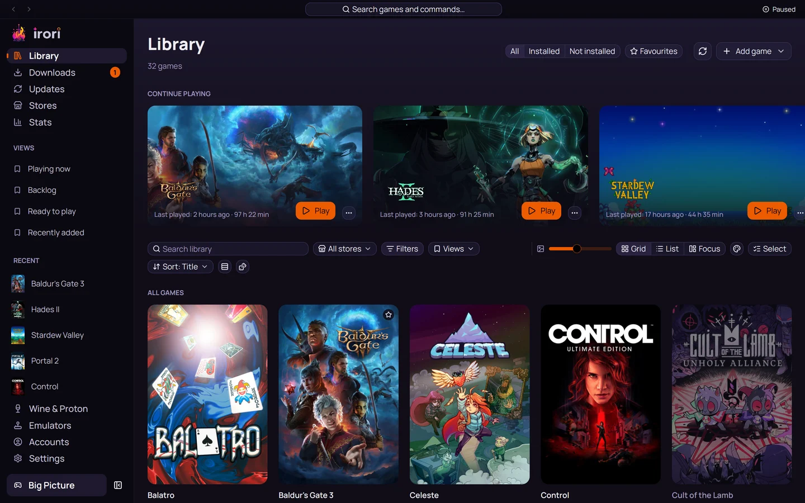

<p align="center">
  <picture>
    <source media="(prefers-color-scheme: dark)" srcset="assets/brand/irori-lockup-dark.svg">
    
  </picture>
</p>

<p align="center"><b>Every game you own, around one fire.</b></p>

<p align="center">
  <a href="https://github.com/irori-app/irori/releases/latest"></a>
  <a href="https://github.com/irori-app/irori/releases"></a>
  <a href="https://github.com/irori-app/irori/stargazers"></a>
  
  
  <a href="LICENSE"></a>
</p>

<p align="center">
  <a href="https://irori.app"><b>Website</b></a> ·
  <a href="#install"><b>Install</b></a> ·
  <a href="SECURITY.md"><b>Security & Privacy</b></a> ·
  <a href="THIRD-PARTY-NOTICES.md"><b>Third-Party Notices</b></a> ·
  <a href="docs/FEATURES.md"><b>Full Features</b></a>
</p>

<p align="center">
  <picture>
    <source media="(prefers-color-scheme: light)" srcset="website/public/screenshots/light-library.webp">
    
  </picture>
</p>

Irori is a native Rust game launcher rendered on your GPU with GPUI for Linux, macOS, and Windows. It gathers your Epic Games, GOG, Amazon Games, ZOOM Platform, itch.io, Steam, emulated, and sideloaded games into one library without bundling an embedded browser.

Security and privacy guarantees: Irori collects zero telemetry, analytics, or remote crash reports. See [SECURITY.md](SECURITY.md) for the exact network endpoints, encrypted credential storage (`AES-256-GCM`), and how to report vulnerabilities. See [THIRD-PARTY-NOTICES.md](THIRD-PARTY-NOTICES.md) for protocol ports, vendored crates, and behavioral references.

## Feature Maturity

| Area | Status | Notes |
| --- | --- | --- |
| Epic Games, GOG, Steam, Sideload | Stable | Built-in Rust Epic/GOG protocols; local and optional login Steam sync |
| Heroic / Lutris import, Wine / Proton / umu | Stable | One-click import, multi-runtime manager, prefix setup, and cloud saves |
| Amazon Games, itch.io, ZOOM Platform, Emulators | Beta | Functional store installs/updates and managed emulator downloads |
| Xbox / PC Game Pass on Linux (`msixvc`/`msstore` + Nexus Runtime), Lutris scripts, OptiScaler, RenoDX | Experimental | Opt-in integrations; still evolving across titles and hardware |
| Non-English translations (18 languages besides English) | Partial | English is maintained directly; community translation reviews are welcome |

For the full feature guide (downloads, MangoHud/Metal HUD, gamescope, Big Picture, replay buffer, IGDB/VNDB, and Sunshine sync), see [docs/FEATURES.md](docs/FEATURES.md).

## Install

Ordered by package trust channel on each operating system (all files are on the [latest release](https://github.com/irori-app/irori/releases/latest) and [irori.app/#download](https://irori.app/#download)):

### Linux

1. Flatpak bundle (also Steam Deck Desktop Mode; Flathub submission is planned):
   ```bash
   flatpak remote-add --if-not-exists --user flathub https://dl.flathub.org/repo/flathub.flatpakrepo
   flatpak install --user ./Irori-*-linux.flatpak
   ```
2. AppImage: download `Irori-…-x86_64.AppImage` (or `-aarch64.AppImage`), `chmod +x`, and run.
3. GPG-verified `packages.irori.app` repositories (Fedora COPR and AUR publishing are planned):
   <details>
   <summary>Debian, Ubuntu, Mint, Pop!_OS / Fedora, openSUSE / Arch, CachyOS</summary>

   ```bash
   # Debian / Ubuntu / Mint / Pop!_OS
   sudo apt install -y curl
   curl -fsSL https://packages.irori.app/irori.gpg | sudo tee /usr/share/keyrings/irori.gpg > /dev/null
   curl -fsSL https://packages.irori.app/irori.list | sudo tee /etc/apt/sources.list.d/irori.list
   sudo apt update && sudo apt install irori

   # Fedora / openSUSE
   sudo curl -fsSLo /etc/yum.repos.d/irori.repo https://packages.irori.app/irori.repo
   sudo dnf install irori

   # Arch / Manjaro / EndeavourOS / CachyOS
   curl -fsSLo /tmp/irori.asc https://packages.irori.app/irori.asc
   sudo pacman-key --add /tmp/irori.asc && sudo pacman-key --lsign-key 6DD7B72703FE3BD5C719F4CE6FE681AB798DF656
   printf '\n[irori]\nServer = https://packages.irori.app/arch/$arch\n' | sudo tee -a /etc/pacman.conf
   sudo pacman -Syu irori
   ```

   </details>
4. Build from source (see [Building](#building)).

### Windows

1. Scoop (winget publishing is planned):
   ```powershell
   scoop bucket add irori https://github.com/irori-app/scoop-bucket
   scoop install irori
   ```
2. Per-user setup or portable zip: download `Irori-…-windows-setup.exe` (no admin rights required) or `Irori-…-windows-portable.zip` from the latest release. Builds are not yet Authenticode-signed, so SmartScreen may prompt on first launch.

### macOS

1. Homebrew cask: `brew install --cask irori-app/tap/irori`
2. Signed and notarized `.dmg` for Apple silicon and Intel from the latest release.

## Performance

Measured on Linux (`Irori 1.1.0`, CachyOS, KDE Wayland, AMD Radeon RX 9070 XT, Mesa `26.3.1`, `108.1 MB` binary) across seeded local libraries (`compare.py --irori-only --settle 20 --idle 15`):

| Library size | Memory PSS (median) | Processes | Idle CPU (median) |
| --- | --- | --- | --- |
| 0 games | 88.3 MiB | 1 | 2.30 % |
| 300 games (with covers) | 119.4 MiB | 1 | 2.00 % |
| 1,000 games (with covers) | 126.0 MiB | 1 | 1.90 % |

In the historical `0.2.0` empty-profile comparison (`--settle 45`, `--idle 30`), Irori used 87.5 MiB across 1 process while Heroic 2.22.4 used 478.2 MiB across 7 processes. See [docs/BENCHMARKS.md](docs/BENCHMARKS.md) for methodology, hardware details, and limits.

## Building

Requires Rust 1.95+. Linux needs GPUI system libraries (Vulkan, Wayland, X11/xcb, xkbcommon, fontconfig, freetype); the optional `irori-sign-in` helper also uses GTK 3 and WebKitGTK 4.1 (`cargo build -p irori-sign-in`).

```bash
cargo run --release -p irori
# Optional per-user Linux desktop install:
packaging/install.sh
```

See [docs/PLATFORMS.md](docs/PLATFORMS.md) for macOS/Windows build details and data paths, [docs/RELEASING.md](docs/RELEASING.md) for release packaging, and [docs/RELEASE_QA.md](docs/RELEASE_QA.md) for the release verification checklist.

## Layout

| Path | Purpose |
| --- | --- |
| `crates/core`, `crates/secrets`, `crates/services` | Domain model, `Paths`, encrypted logins, library facade |
| `crates/runtime`, `crates/engines`, `crates/mods`, `crates/reshade` | Wine/Proton/umu, emulators, mod installers, ReShade/RenoDX |
| `crates/depot`, `crates/epic`, `crates/gog`, `crates/amazon`, `crates/ms*` | Chunked downloads and native store protocol crates |
| `crates/store-*`, `crates/extras`, `crates/scripts` | Store integrations, importers, trackers, Lutris scripts |
| `crates/ui`, `crates/feature-*`, `crates/irori`, `crates/sign-in` | GPUI interface, screens, shell binary, sign-in helper |

See [AGENTS.md](AGENTS.md) and [docs/ARCHITECTURE.md](docs/ARCHITECTURE.md) (once merged) for crate rules.
## Notes

- Store sign-ins use the optional `irori-sign-in` helper window (WebKitGTK on Linux, WKWebView on macOS, WebView2 on Windows) and fall back cleanly to your system browser when omitted.
- Opt-in integrations (IGDB, VNDB, SteamGridDB, Discord Rich Presence, Sunshine/Apollo sync, and LaunchBox artwork) stay disabled or idle until you turn them on or look up a game.
- `IRORI_HOME` relocates all config, data, and cache directories under one root (on Windows, a `portable` file next to `irori.exe` does the same).
- Compare trade-offs with Heroic, Lutris, and Playnite on [irori.app/compare](https://irori.app/compare/): mature launchers still hold advantages in battle-tested Flathub distribution (Heroic), legacy community install scripts (Lutris), or Windows plugin ecosystems (Playnite).
- For hardware requirements, translation guidelines, and platform-specific data paths, check [docs/PLATFORMS.md](docs/PLATFORMS.md) and [CONTRIBUTING.md](CONTRIBUTING.md).

## License

MIT, see [LICENSE](LICENSE). See [THIRD-PARTY-NOTICES.md](THIRD-PARTY-NOTICES.md) for bundled assets, vendored crates, upstream store protocol attributions, and behavioral references.

## Contributing

Read [CONTRIBUTING.md](CONTRIBUTING.md) and our [code of conduct](CODE_OF_CONDUCT.md) before opening a pull request.
