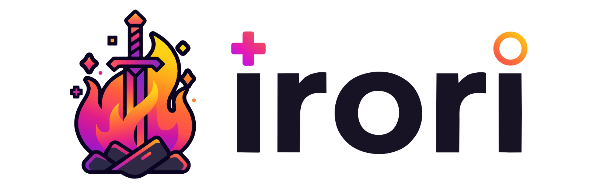
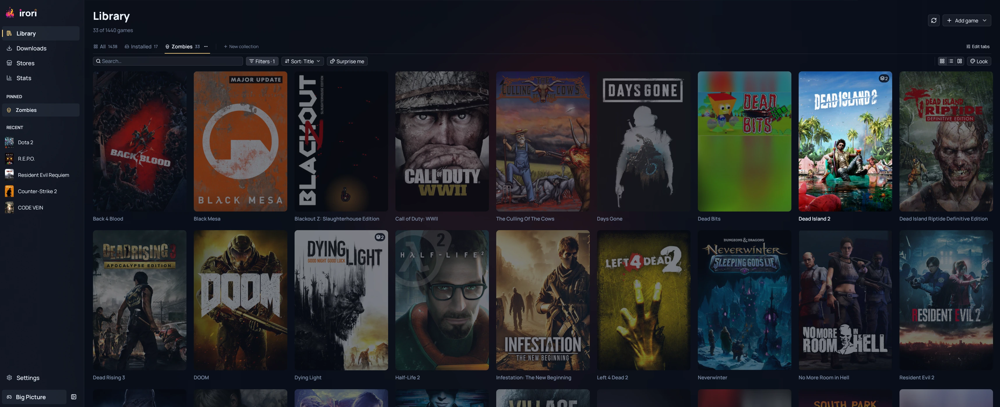
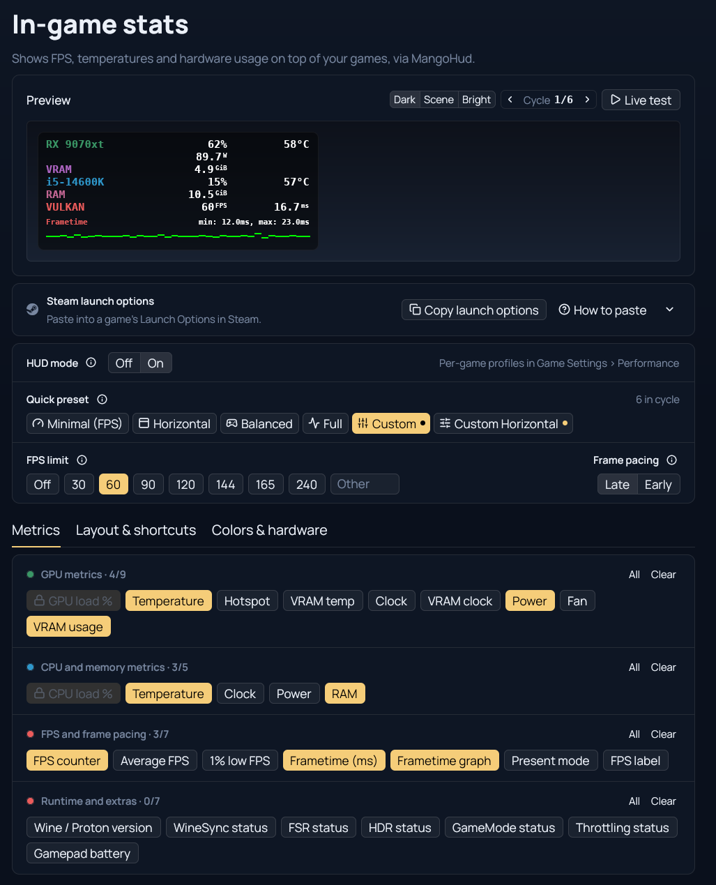
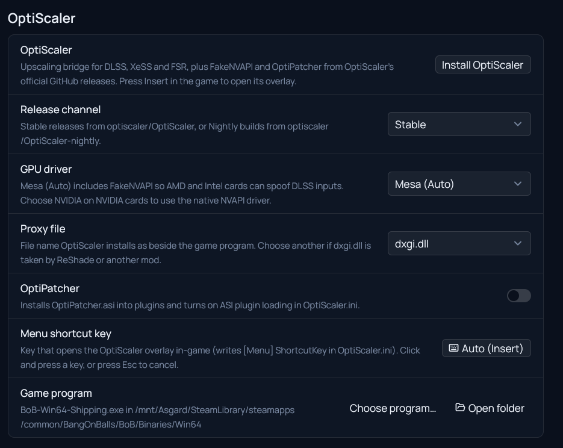
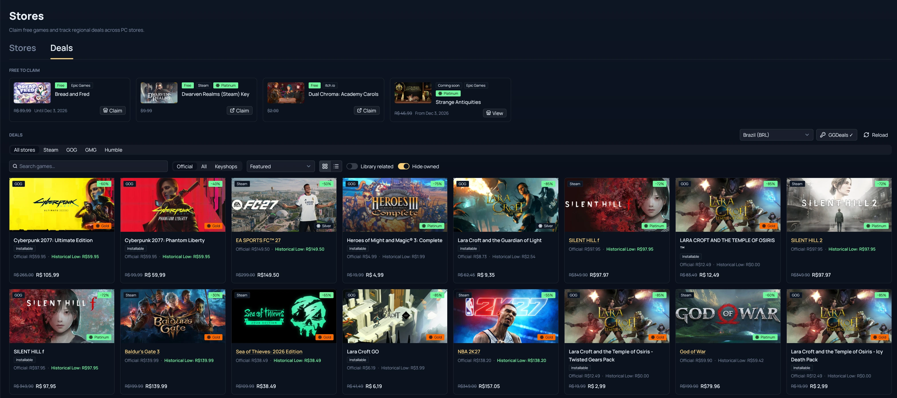
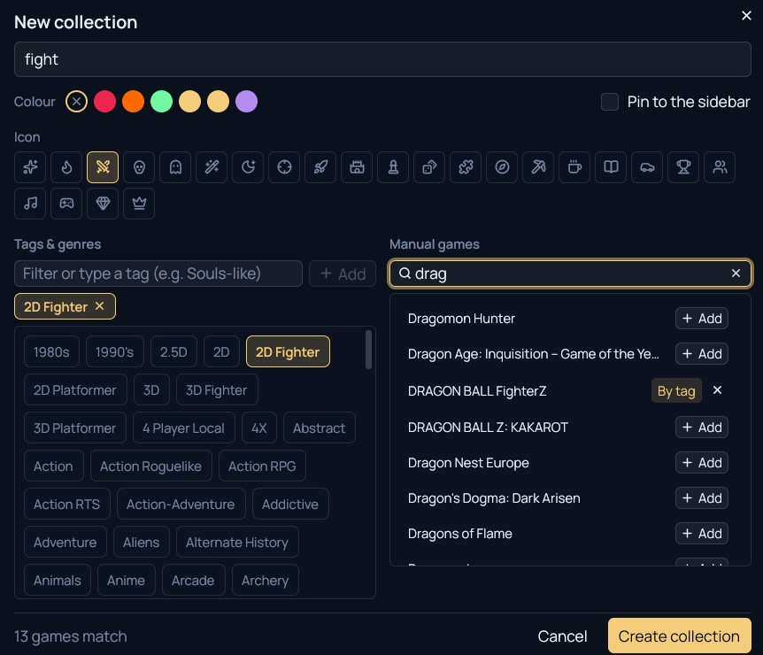
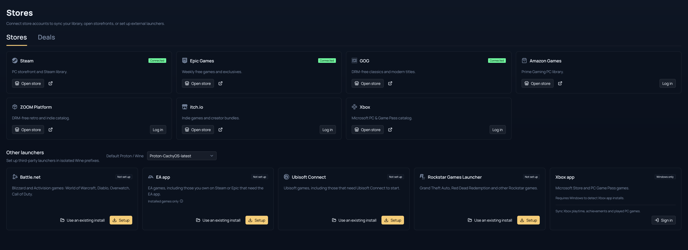
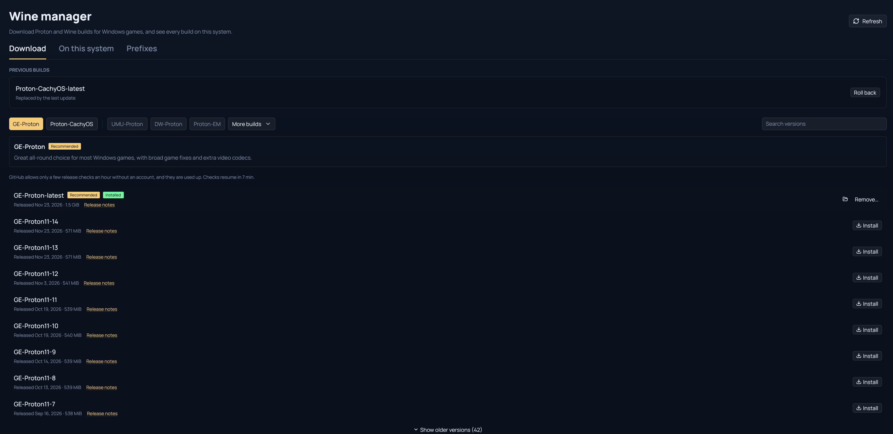
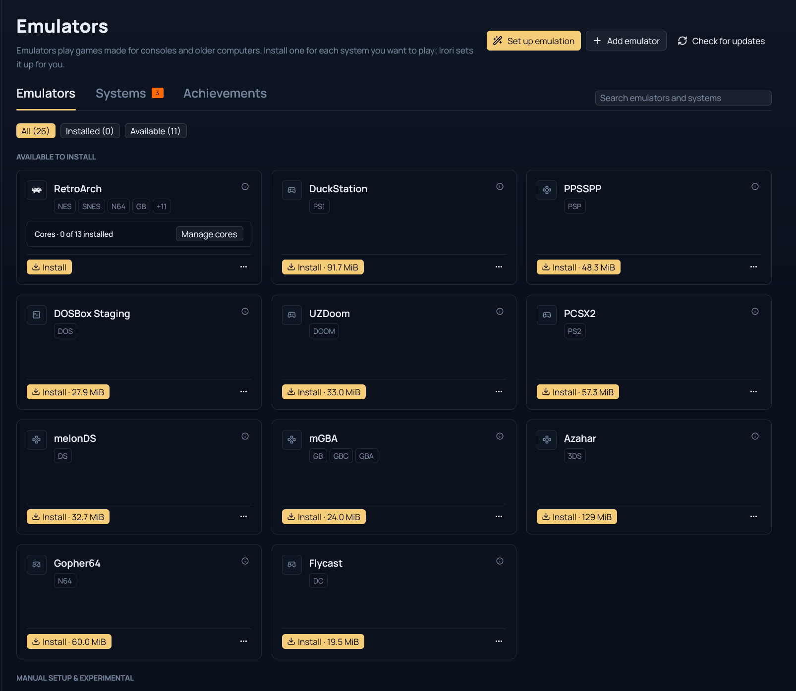
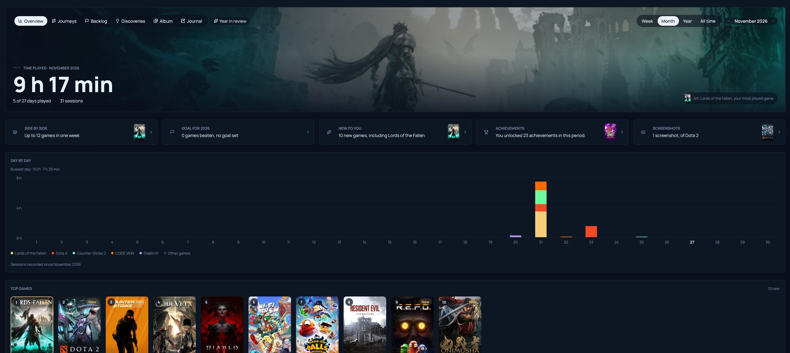

<p align="center">
  <picture>
    <source media="(prefers-color-scheme: dark)" srcset="assets/brand/irori-lockup-dark.svg">
    
  </picture>
</p>

<p align="center"><b>Every game you own, around one fire.</b></p>

<p align="center">
  <a href="https://github.com/irori-app/irori/releases/latest"></a>
  <a href="https://github.com/irori-app/irori/releases"></a>
  <a href="https://github.com/irori-app/irori/stargazers"></a>
  
  
  <a href="LICENSE"></a>
</p>

<p align="center">
  <a href="https://irori.app"><b>Website</b></a> ·
  <a href="#highlights"><b>Highlights</b></a> ·
  <a href="#install"><b>Install</b></a> ·
  <a href="SECURITY.md"><b>Security & Privacy</b></a> ·
  <a href="THIRD-PARTY-NOTICES.md"><b>Third-Party Notices</b></a> ·
  <a href="docs/FEATURES.md"><b>Full Features</b></a>
</p>

<p align="center">
  
</p>

Irori is a native Rust game launcher rendered on your GPU with GPUI for Linux, macOS, and Windows. It gathers your Epic Games, GOG, Amazon Games, ZOOM Platform, itch.io, Steam, emulated, and sideloaded games into one fast library without bundling an embedded browser.

Built around Click-and-Play UX, Irori picks safe defaults automatically so launching or installing a game takes minimal clicks, while keeping deep options (Wine/Proton/umu tuning, HUD presets, upscalers, mods, saves, emulators, and Big Picture) neatly organized until you want them.

Security and privacy guarantees: Irori collects zero telemetry, analytics, or remote crash reports. See [SECURITY.md](SECURITY.md) for the exact network endpoints, encrypted credential storage (`AES-256-GCM`), and how to report vulnerabilities. See [THIRD-PARTY-NOTICES.md](THIRD-PARTY-NOTICES.md) for protocol ports, vendored crates, and behavioral references.

## Highlights

### Click-and-Play in practice

- Auto-detects installed Proton, Wine, or umu runtimes, default prefixes, controllers, emulators, ROMs, and install drives with free space so new games launch without manual setup.
- Imports existing libraries, accounts, installs, settings, favorites, categories, and playtime in one click from Heroic, Lutris, Bottles, Faugus Launcher, and Playnite (on Windows).
- Shows clear storage cards (`Download`, `Space needed`, `Free after`) and clickable drive/library cards in the install dialog, tucking advanced options under "More options".
- Explains failed launches in plain language with one-click fixes, and opens a reviewable crash report sheet with automatic home-path redaction (`~` or `%USERPROFILE%`) if Irori ever crashes.

### Windows `.exe` and `.msi` installers without hunting for binaries

- Run Windows setup programs (`.exe` and `.msi`, including Inno Setup repacks) directly inside a game's Wine or Proton prefix from `Add game`.
- When the installer finishes, Irori scans the prefix automatically, selects the installed game executable (filtering out uninstallers, redistributables, and crash handlers), and offers an inline picker if more than one candidate is found.
- Infers clean game titles from parent folders when running `setup.exe` and auto-fills cover and hero art via Steam store search (or lets you pick local art and SteamGridDB).

### Built-in MangoHud, OptiScaler, and visual tools

- Configure MangoHud on Linux globally or per game with a pinned live preview (`Dark`, `Scene`, `Bright` backdrops and `Live test`), quick presets (`Minimal (FPS)`, `Horizontal`, `Balanced`, `Full`, `Custom`, `Custom Horizontal`), FPS limit with `Late`/`Early` frame pacing, live in-game reload, a configurable hotkey to cycle presets in-game, a color wheel with WCAG contrast warnings, a visual monitor position grid, and a side-by-side Steam launch option paste guide (plus Metal HUD on macOS).
- Manage OptiScaler (`Stable` and `Nightly` channels, `Mesa (Auto)` with `FakeNVAPI`, `OptiPatcher`, proxy DLL selector, and custom menu shortcut key), ReShade, and RenoDX HDR from official releases with SHA-256 tracking for clean removal. OptiScaler supports global defaults, menu shortcut sync across installed games, confirmation before overwriting proxy DLLs, Unity render API detection, and Steam Windows games running under Proton on Linux.
- Toggle gamescope, GameMode, DXVK/VKD3D-Proton versions, DLSS/FSR/XeSS upgrades, frame generation (`lsfg-vk` or MAKO), NVIDIA Smooth Motion, Vulkan Reflex, unified FPS caps, and per-game replay clips (`gpu-screen-recorder`) from one place.

<table>
  <tr>
    <td width="50%" align="center" valign="top">
      <br>
      <sub><b>Built-in MangoHud editor with live preview and Steam paste guide</b></sub>
    </td>
    <td width="50%" align="center" valign="top">
      <br>
      <sub><b>OptiScaler with FakeNVAPI, OptiPatcher, and proxy DLL management</b></sub>
    </td>
  </tr>
</table>

### Library, unified downloads, and ecosystem

- Organize large libraries with customizable tabs (`All`, `Installed`, `Favorites`, `Recently added`), Steam-style hybrid collections (automatic tag/genre rules combined with manual picks and exclusions, custom colors, 24 icons, and sidebar pinning), ProtonDB and Steam Deck badges on covers, `On hover` cover captions, and a `Surprise me` shuffle card.
- Browse Stores and Deals with "Free to claim" games, multi-currency historical lows, ProtonDB ratings on deals, a toggle to hide games you own, and optional GG.deals integration.
- Track active downloads, queued installs ("Download now" jumps any queued game to the front without losing progress), game updates, Wine/Proton/emulator updates, and Irori self-updates in a single unified Downloads view.
- Manage Wine and Proton builds (`GE-Proton`, `Proton-CachyOS`, `UMU-Proton`, `DW-Proton`, `Proton-EM`, `Proton-Sarek`, Game Porting Toolkit, and more), register builds directly with Steam, auto-update `-latest` builds while keeping stable Steam compatibility names, and roll back to previous builds in one click.
- Install managed emulators including RetroArch (with searchable core management), DuckStation, PCSX2, PPSSPP, DOSBox Staging, Flycast, melonDS, mGBA, Azahar, Gopher64, and DOOM (`IWAD` detection with built-in UZDoom and GZDoom), alongside per-game mods (Nexus Mods, Thunderstore, FOMOD), Ludusavi save backups, Linux `bubblewrap` sandboxing, personal stats dashboards, and Big Picture controller mode with an in-game overlay.

<p align="center">
  <br>
  <sub><b>Stores and Deals with Free to claim games, historical lows, GG.deals, and ProtonDB ratings</b></sub>
</p>

<details>
<summary>More screenshots: hybrid collections, stores &amp; launchers, Wine/Proton manager, emulators, and personal stats</summary>

<br>

<p align="center">
  <br>
  <sub><b>Hybrid collection builder: combine automatic tag/genre rules with manual picks</b></sub>
</p>

<p align="center">
  <br>
  <sub><b>All stores and third-party launchers (Battle.net, EA app, Ubisoft Connect, Rockstar, Xbox app) in one place</b></sub>
</p>

<p align="center">
  <br>
  <sub><b>Wine and Proton manager with Steam linking, -latest auto-updates, and one-click rollback</b></sub>
</p>

<p align="center">
  <br>
  <sub><b>Managed emulators (including RetroArch cores and UZDoom) ready to install</b></sub>
</p>

<p align="center">
  <br>
  <sub><b>Personal Stats with playtime breakdown, goals, achievements, daily activity, and top games</b></sub>
</p>

</details>

For the full feature reference across all screens and platforms, see [docs/FEATURES.md](docs/FEATURES.md).

## Install

Ordered by package trust channel on each operating system (all files are on the [latest release](https://github.com/irori-app/irori/releases/latest) and [irori.app/#download](https://irori.app/#download)):

### Linux

1. Flatpak bundle (also Steam Deck Desktop Mode; Flathub submission is planned):
   ```bash
   flatpak remote-add --if-not-exists --user flathub https://dl.flathub.org/repo/flathub.flatpakrepo
   flatpak install --user ./Irori-*-linux.flatpak
   ```
2. AppImage: download `Irori-…-x86_64.AppImage` (or `-aarch64.AppImage`), `chmod +x`, and run.
3. GPG-verified `packages.irori.app` repositories (Fedora COPR and AUR publishing are planned):
   <details>
   <summary>Debian, Ubuntu, Mint, Pop!_OS / Fedora, openSUSE / Arch, CachyOS</summary>

   ```bash
   # Debian / Ubuntu / Mint / Pop!_OS
   sudo apt install -y curl
   curl -fsSL https://packages.irori.app/irori.gpg | sudo tee /usr/share/keyrings/irori.gpg > /dev/null
   curl -fsSL https://packages.irori.app/irori.list | sudo tee /etc/apt/sources.list.d/irori.list
   sudo apt update && sudo apt install irori

   # Fedora / openSUSE
   sudo curl -fsSLo /etc/yum.repos.d/irori.repo https://packages.irori.app/irori.repo
   sudo dnf install irori

   # Arch / Manjaro / EndeavourOS / CachyOS
   curl -fsSLo /tmp/irori.asc https://packages.irori.app/irori.asc
   sudo pacman-key --add /tmp/irori.asc && sudo pacman-key --lsign-key 6DD7B72703FE3BD5C719F4CE6FE681AB798DF656
   printf '\n[irori]\nServer = https://packages.irori.app/arch/$arch\n' | sudo tee -a /etc/pacman.conf
   sudo pacman -Syu irori
   ```

   </details>
4. Build from source (see [Building](#building)).

### Windows

1. Scoop (winget publishing is planned):
   ```powershell
   scoop bucket add irori https://github.com/irori-app/scoop-bucket
   scoop install irori
   ```
2. Per-user setup or portable zip: download `Irori-…-windows-setup.exe` (no admin rights required) or `Irori-…-windows-portable.zip` from the latest release. Builds are not yet Authenticode-signed, so SmartScreen may prompt on first launch.

### macOS

1. Homebrew cask: `brew install --cask irori-app/tap/irori`
2. Signed and notarized `.dmg` for Apple silicon and Intel from the latest release.

## Feature Maturity

| Area | Status | Notes |
| --- | --- | --- |
| Epic Games, GOG, Steam, Sideload | Stable | Built-in Rust Epic/GOG protocols; local and optional Steam sync; automatic `.exe`/`.msi` installer executable detection |
| Heroic / Lutris / Bottles / Faugus / Playnite import, Wine / Proton / umu, MangoHud / Metal HUD | Stable | One-click migration, multi-runtime manager with Steam linking and rollback, prefix setup, cloud/Ludusavi saves, and live HUD editor |
| Amazon Games, itch.io, ZOOM Platform, Emulators | Beta | Functional store installs/updates, managed emulator downloads, and DOOM (`IWAD` + UZDoom/GZDoom) |
| Xbox / PC Game Pass on Linux (`msixvc`/`msstore` + Nexus Runtime), Lutris scripts, OptiScaler, RenoDX | Experimental | Opt-in integrations; OptiScaler includes global defaults, Steam Proton support, and SHA-256 clean removal, while title and hardware coverage is still evolving |
| Non-English translations (18 languages besides English) | Partial | English is maintained directly; community translation reviews are welcome |

## Performance

Measured on Linux (`Irori 1.1.0`, CachyOS, KDE Wayland, AMD Radeon RX 9070 XT, Mesa `26.3.1`, `108.1 MB` binary, `--settle 45 --idle 30`, host overlays disabled):

| Scenario | Memory PSS (median) | Processes | Idle CPU (median) |
| --- | --- | --- | --- |
| 0 games (synthetic empty) | 122.4 MiB | 1 | 0.02 % |
| 300 games (rich synthetic + art) | 146.8 MiB | 1 | 0.00 % |
| 1,000 games (rich synthetic + art) | 147.7 MiB | 1 | 0.02 % |
| 1,440 games (real multi-store library) | 385.1 MiB | 1 | 0.03 % |

In the historical `0.2.0` empty-profile comparison (`--settle 45`, `--idle 30`), Irori used 87.5 MiB across 1 process while Heroic 2.22.4 used 478.2 MiB across 7 processes. See [docs/BENCHMARKS.md](docs/BENCHMARKS.md) for methodology, screenshots, hardware details, and limits.

## Building

Requires Rust 1.95+. Linux needs GPUI system libraries (Vulkan, Wayland, X11/xcb, xkbcommon, fontconfig, freetype); the optional `irori-sign-in` helper also uses GTK 3 and WebKitGTK 4.1 (`cargo build -p irori-sign-in`).

```bash
cargo run --release -p irori
# Optional per-user Linux desktop install:
packaging/install.sh
```

See [docs/PLATFORMS.md](docs/PLATFORMS.md) for macOS/Windows build details and data paths, [docs/RELEASING.md](docs/RELEASING.md) for release packaging, and [docs/RELEASE_QA.md](docs/RELEASE_QA.md) for the release verification checklist.

## Layout

| Path | Purpose |
| --- | --- |
| `crates/core`, `crates/secrets`, `crates/services` | Domain model, `Paths`, encrypted logins, library facade |
| `crates/runtime`, `crates/engines`, `crates/mods`, `crates/reshade` | Wine/Proton/umu, emulators, mod installers, ReShade/RenoDX/OptiScaler |
| `crates/depot`, `crates/epic`, `crates/gog`, `crates/amazon`, `crates/ms*` | Chunked downloads and native store protocol crates |
| `crates/store-*`, `crates/extras`, `crates/scripts` | Store integrations, importers, trackers, Lutris scripts |
| `crates/ui`, `crates/feature-*`, `crates/irori`, `crates/sign-in` | GPUI interface, screens, shell binary, sign-in helper |

See [AGENTS.md](AGENTS.md) and [docs/ARCHITECTURE.md](docs/ARCHITECTURE.md) for crate rules.

## Notes

- Store sign-ins use the optional `irori-sign-in` helper window (WebKitGTK on Linux, WKWebView on macOS, WebView2 on Windows) and fall back cleanly to your system browser when omitted.
- Opt-in integrations (IGDB, VNDB, SteamGridDB, GG.deals, Discord Rich Presence, Sunshine/Apollo sync, and LaunchBox artwork) stay disabled or idle until you turn them on or look up a game.
- `IRORI_HOME` relocates all config, data, and cache directories under one root (on Windows, a `portable` file next to `irori.exe` does the same).
- Compare trade-offs with Heroic, Lutris, and Playnite on [irori.app/compare](https://irori.app/compare/): mature launchers still hold advantages in battle-tested Flathub distribution (Heroic), legacy community install scripts (Lutris), or Windows plugin ecosystems (Playnite).
- For hardware requirements, translation guidelines, and platform-specific data paths, check [docs/PLATFORMS.md](docs/PLATFORMS.md) and [CONTRIBUTING.md](CONTRIBUTING.md).

## License

GPL-3.0-or-later, see [LICENSE](LICENSE). See [THIRD-PARTY-NOTICES.md](THIRD-PARTY-NOTICES.md) for bundled assets, vendored crates, upstream store protocol attributions, and behavioral references.

## Contributing

Read [CONTRIBUTING.md](CONTRIBUTING.md) and our [code of conduct](CODE_OF_CONDUCT.md) before opening a pull request.
