<p align="center">
  <picture>
    <source media="(prefers-color-scheme: dark)" srcset="assets/brand/irori-lockup-dark.svg">
    
  </picture>
</p>

<p align="center"><b>Every game you own, around one fire.</b></p>

<p align="center">
  <a href="https://github.com/irori-app/irori/releases/latest"></a>
  <a href="https://github.com/irori-app/irori/releases"></a>
  <a href="https://github.com/irori-app/irori/stargazers"></a>
  
  
  <a href="LICENSE"></a>
  <a href="https://x.com/irorilauncher"></a>
</p>

<p align="center">
  <a href="https://irori.app"><b>Website</b></a> ·
  <a href="#install"><b>Install</b></a> ·
  <a href="https://github.com/irori-app/irori/releases/latest"><b>Latest release</b></a> ·
  <a href="https://x.com/irorilauncher"><b>X (@irorilauncher)</b></a>
</p>

<p align="center">
  <picture>
    <source media="(prefers-color-scheme: light)" srcset="website/public/screenshots/light-library.webp">
    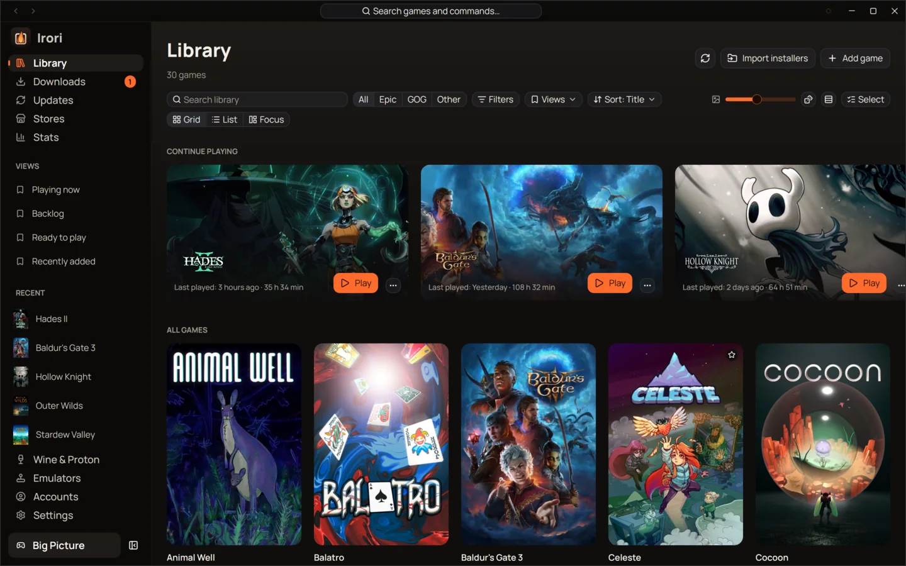
  </picture>
</p>

An *irori* (囲炉裏) is the sunken hearth of a traditional Japanese house, the place
everyone gathers. Irori is a fast, native game launcher for **Linux, macOS and
Windows** that gathers your **Epic Games**, **GOG**, **Amazon Games**, **ZOOM
Platform** and **itch.io** libraries, your **Steam** games, your emulated games and
anything you add yourself into one calm library. Windows games run natively on
Windows, through Wine, Proton or umu on Linux, and through Wine, CrossOver or Game
Porting Toolkit on macOS.

It is one native Rust process drawn on your graphics card, with no browser inside and
no store tools to download: the Epic, GOG and Amazon protocols are built in.

## Install

| Platform | Packages |
| :--- | :--- |
| 🐧 **Linux** | apt, dnf and pacman repositories at `packages.irori.app`, a Flatpak bundle (also for Steam Deck), tarball |
| 🍎 **macOS** | Signed and notarized `.dmg` for Apple silicon and Intel, Homebrew cask |
| 🪟 **Windows** | Installer for your user (no administrator rights), Scoop bucket |

Every file is on the [latest release](https://github.com/irori-app/irori/releases/latest),
and [irori.app](https://irori.app/#download) has the same commands.

<details>
<summary><b>Debian, Ubuntu, Mint, Pop!_OS</b></summary>

```bash
sudo apt install -y curl
curl -fsSL https://packages.irori.app/irori.gpg | sudo tee /usr/share/keyrings/irori.gpg > /dev/null
curl -fsSL https://packages.irori.app/irori.list | sudo tee /etc/apt/sources.list.d/irori.list
sudo apt update && sudo apt install irori
```

</details>

<details>
<summary><b>Fedora, openSUSE</b></summary>

```bash
sudo curl -fsSLo /etc/yum.repos.d/irori.repo https://packages.irori.app/irori.repo
sudo dnf install irori
```

</details>

<details>
<summary><b>Arch, Manjaro, EndeavourOS, CachyOS</b></summary>

```bash
curl -fsSLo /tmp/irori.asc https://packages.irori.app/irori.asc
sudo pacman-key --add /tmp/irori.asc && sudo pacman-key --lsign-key 6DD7B72703FE3BD5C719F4CE6FE681AB798DF656
printf '\n[irori]\nServer = https://packages.irori.app/arch/$arch\n' | sudo tee -a /etc/pacman.conf
sudo pacman -Syu irori
```

</details>

<details>
<summary><b>Flatpak and Steam Deck</b></summary>

Download `Irori-…-linux.flatpak` from the [latest release](https://github.com/irori-app/irori/releases/latest),
then (on Steam Deck, in Desktop Mode):

```bash
flatpak remote-add --if-not-exists --user flathub https://dl.flathub.org/repo/flathub.flatpakrepo
flatpak install --user ./Irori-*-linux.flatpak
```

Irori isn't on Flathub yet, so install each new version the same way.

</details>

<details>
<summary><b>macOS</b></summary>

```bash
brew install --cask irori-app/tap/irori
```

Or download the `.dmg` for Apple silicon or Intel from the
[latest release](https://github.com/irori-app/irori/releases/latest) and drag Irori to
Applications.

</details>

<details>
<summary><b>Windows</b></summary>

Download `Irori-…-windows-setup.exe` from the
[latest release](https://github.com/irori-app/irori/releases/latest). It installs for
your user and never asks for administrator rights. Or with Scoop:

```powershell
scoop bucket add irori https://github.com/irori-app/scoop-bucket
scoop install irori
```

Windows builds aren't signed yet, so SmartScreen may warn the first time: choose
**More info**, then **Run anyway**.

</details>

Flathub, winget and the AUR are planned. To build Irori yourself, see [Building](#building).

---

## Every store, one library

- **Epic Games, GOG, Amazon Games, ZOOM Platform and itch.io:** log in and install,
  update, repair, move or import games from one download queue, with several accounts
  per store. Each installed game launches with the account it was installed with.
- **Xbox app and PC Game Pass on Windows:** games the Xbox app or the Microsoft Store
  installed show up by themselves once "Other launchers" is on, with their own art and
  size, and start in one click. No sign-in.
- **Steam:** your installed games come in from Steam's own files with no login, with
  Steam's art. Log in (QR code, or password with Steam Guard) to add every game you own
  and your Steam Family's games. Playtime counts, and Install, Verify files and Uninstall
  open Steam's own dialogs. On Linux, pick the Proton build (GE-Proton too) Steam runs a
  game with, next to its ProtonDB rating.
- **Fuzzy search, filters, sorting, categories, favourites and hidden games**, in a grid
  or a sortable list, virtualized for libraries of any size; start typing anywhere in
  the grid or list to search. Filter by genre, and group by play status, game mode,
  genre or category. Categories are manual (you put games in them) or smart (filled
  from rules: store, tags, game mode, play status, age rating, installed, playtime, last
  played, HowLongToBeat length, system, another category or a search, with All/Any and
  "Leave out" rows); both can be pinned (pinned ones get a Big Picture shelf) and
  coloured, show their counts in the Views menu, and travel with backups and sync. A
  saved view can become a smart category. "Continue playing", installed
  games by drive, and a random pick (<kbd>Ctrl</kbd> <kbd>Shift</kbd> <kbd>G</kbd>).
  On a wide window the header adds one-click sort, installed, favourites and grouping
  controls, as many as fit (Settings → Appearance turns them off).
- **Three views, one click apart** (<kbd>Alt</kbd> <kbd>1</kbd>–<kbd>3</kbd>): the grid,
  where a click opens a resizable drawer with the game's art, Play, status, rating, play
  stats and screenshots; the sortable list; and Focus, a column of covers beside the
  selected game's whole page over its art. Arrow keys move the selection in each.
- **One entry per game**, however many stores you own it on: it plays the installed
  copy, its page switches between the Steam, Epic Games or GOG copies, and you can
  combine or separate copies yourself. Each keeps its own playtime and achievements.
- **Add any game** yourself, with its own description, developer, release date, genres
  and art from SteamGridDB, or drop its program, shortcut or folder onto the library.
- **Your own art for any game:** a cover, background and logo from a file, SteamGridDB
  or one of your screenshots of it, in the game's Artwork settings.
- **Details from IGDB, if you want them:** with your own free Twitch application,
  descriptions, genres, release dates and screenshots fill in what store pages leave
  out (added games and ROMs above all), and IGDB's covers and artworks join the art
  picker. Off by default; a game is looked up only when you open it.
- **Move in from Heroic or Lutris** in one click: accounts, installs, settings,
  favourites, categories and playtime. Bottles, Faugus Launcher and, on Windows,
  Playnite libraries come along too.

<table>
  <tr>
    <td width="50%" align="center">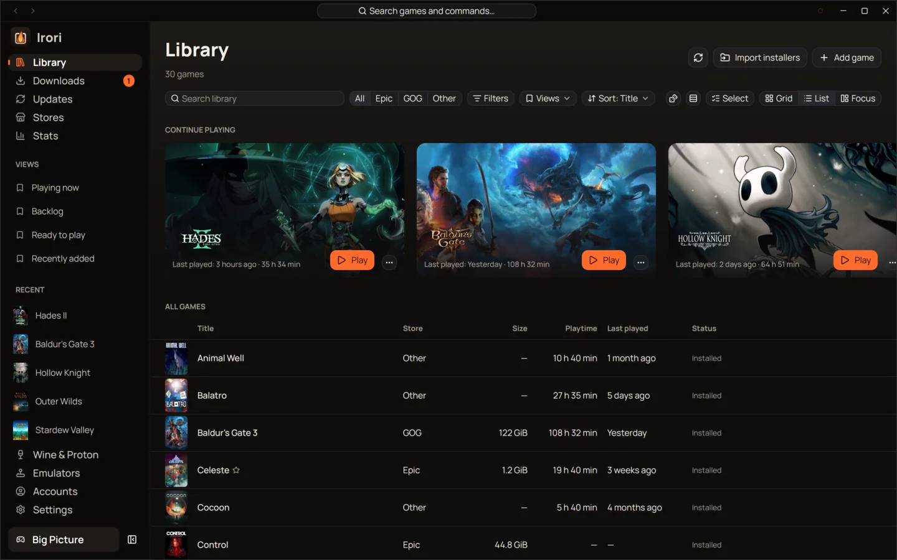<br><sub><b>List view</b></sub></td>
    <td width="50%" align="center">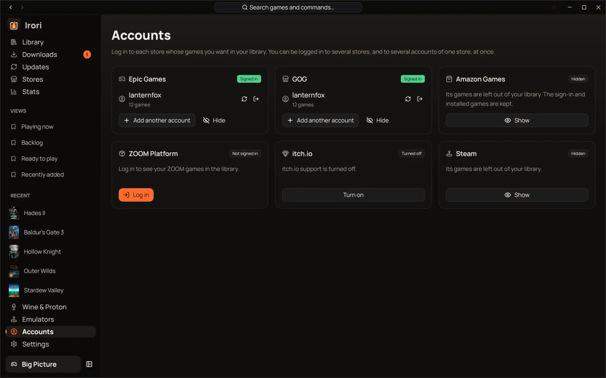<br><sub><b>Every store's accounts in one place</b></sub></td>
  </tr>
</table>

## One click to play

- **Play from anywhere:** library tiles, the game page, the <kbd>Ctrl</kbd> <kbd>K</kbd>
  command palette, the tray menu, desktop and Steam shortcuts, and `irori://` links
  (Heroic's `heroic://` links work too).
- **Game pages over the game's own art**, with a play timeline of your sessions day by
  day, a 1–5 star rating, screenshots and a details table.
- **Per-game settings** inherit your defaults and show exactly what you overrode.
- **Cloud saves** for Epic and GOG, GOG achievements and playtime, the EOS overlay,
  ProtonDB, Steam Deck, anticheat and HowLongToBeat info on every game.
- **Save backups for every game** with [Ludusavi](https://github.com/mtkennerly/ludusavi),
  if you install it: on request or after each session, looking in the game's real Wine or
  Proton prefix, with a list of backups to restore from and a word on which of Ludusavi
  and the store's cloud saves keeps each game.
- **"Add to Steam"** for any game, installed or not; Steam starts Irori, which offers to
  install a game that isn't installed yet.
- **Discord Rich Presence**, sleep held off while you play, and the game's log, which
  can open by itself when the game starts and keeps or hides the lines you filter for.

<table>
  <tr>
    <td width="50%" align="center">
      <picture>
        <source media="(prefers-color-scheme: light)" srcset="website/public/screenshots/light-game.webp">
        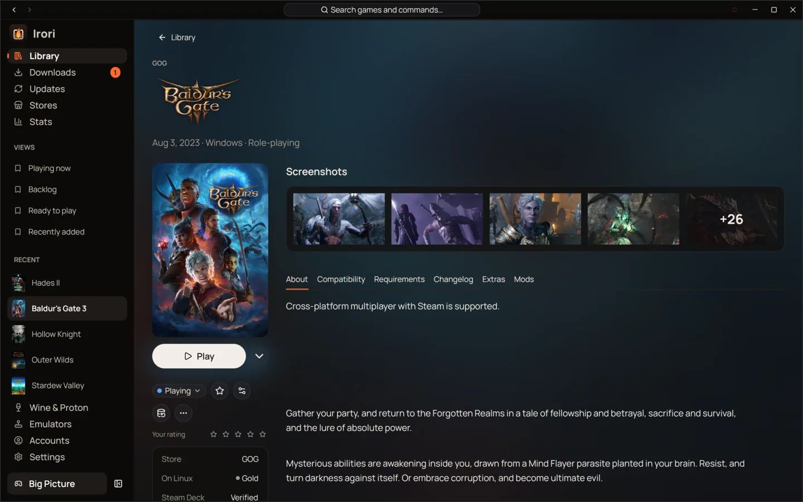
      </picture><br><sub><b>Game page</b></sub>
    </td>
    <td width="50%" align="center">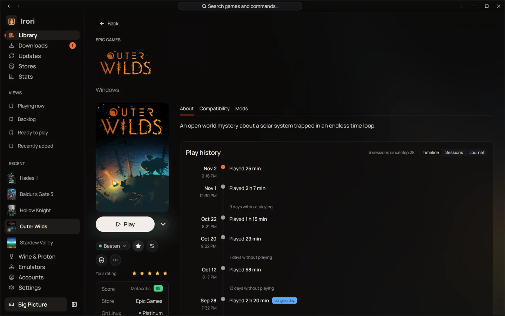<br><sub><b>Play history on every game page</b></sub></td>
  </tr>
</table>

## Downloads and updates

- **One queue** with pause and resume, reordering, speed and time left, history and
  "Update all". Downloads pause when you go offline and resume when you're back, even
  after a restart.
- **One Updates page** for games, Wine and Proton builds, DXVK, VKD3D-Proton, umu, the
  anticheat runtimes, emulators, RetroArch cores and Irori itself: update everything,
  skip a version, stop updating a game, or go back to the Wine build an update
  replaced. Automatic updates can keep to set hours and stay off metered connections.

<table>
  <tr>
    <td width="50%" align="center">
      <picture>
        <source media="(prefers-color-scheme: light)" srcset="website/public/screenshots/light-downloads.webp">
        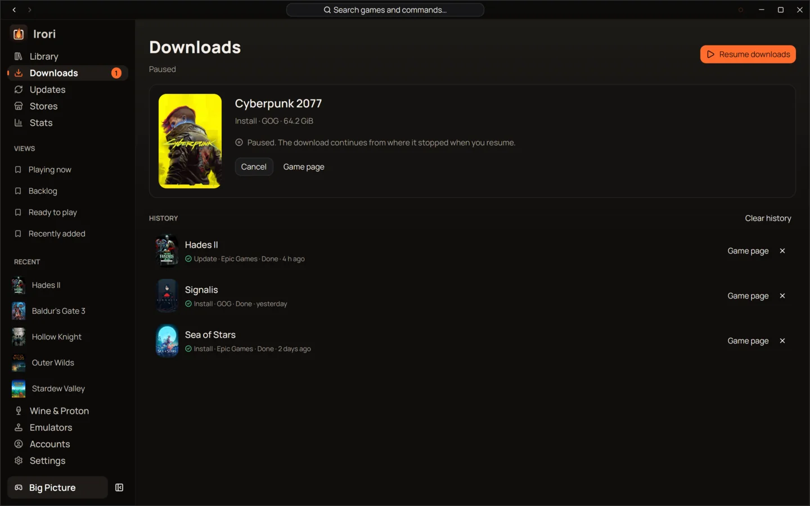
      </picture><br><sub><b>Downloads</b></sub>
    </td>
    <td width="50%" align="center">
      <picture>
        <source media="(prefers-color-scheme: light)" srcset="website/public/screenshots/light-wine.webp">
        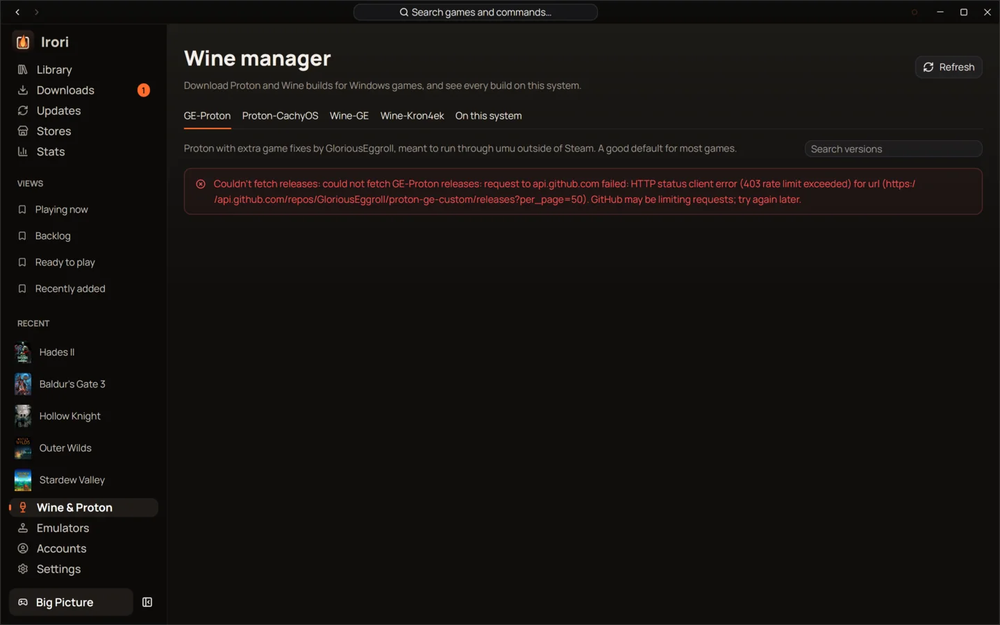
      </picture><br><sub><b>Wine manager</b></sub>
    </td>
  </tr>
</table>

## Wine, Proton and Game Porting Toolkit

- **Wine manager** for GE-Proton, Proton-CachyOS, Wine-GE and Kron4ek on Linux, and
  Wine, CrossOver and Game Porting Toolkit on macOS, plus the system, Steam, Lutris and
  Bottles builds already on your computer.
- **One switch** for gamescope (upscaling optional), MangoHud and GameMode. Pick the
  DXVK and VKD3D-Proton versions per Wine build, and turn on descriptor heap and
  Proton's DLSS, FSR and XeSS upgrades without looking up variables.
- **Graphics tab per game (Linux):** pick which graphics card a game runs on when the
  computer has more than one, turn on NVIDIA Smooth Motion, NVIDIA Reflex for Vulkan
  games, or Lossless Scaling frame generation through lsfg-vk. Every option says why
  it's greyed out when your hardware or drivers can't use it. On Windows the tab sets
  Windows' own graphics preference (power saving or high performance) for the game's
  program, and puts back what was there when you clear it.
- **Your displays, known:** System info lists each display's mode, the modes it offers
  and whether HDR is on, and the HDR and gamescope settings tell you which display has
  HDR and what it runs at.
- **Your folders, your shader cache:** choose where downloaded Wine and Proton builds
  go, and games get 10 GB of shader cache on NVIDIA and Mesa, so big games don't
  compile their shaders again at every start.
- **Third-party launchers on Linux:** Battle.net, the EA app, Ubisoft Connect and
  Rockstar each get a prefix of their own (or bring the prefix you already have), and
  their games join your library.
- **Lutris install scripts**, run with your consent for every download, write and
  command, confined to the game's folder.
- **ReShade and RenoDX HDR** per Windows game, from their official sources only:
  ReShade with its standard shaders, and RenoDX's HDR mod for the game (picked from
  RenoDX's own list, checked against its release's digests) with ReShade's add-on
  build. Every file Irori writes is recorded with its hash; removing deletes only
  what it wrote and you didn't change.
- Winetricks browser, Protontricks for Steam games, the Steam runtime and umu.

## Emulators

- **RetroArch, DuckStation, PCSX2, Dolphin, PPSSPP, melonDS, mGBA, Azahar, ScummVM,
  DOSBox Staging** and more, installed from each project's own servers, side by side by
  version.
- **ROM folders** scanned and watched, with each game's system, region and revision
  from its file name, a generated cover, and the BIOS files each system needs checked
  before you play.

<p align="center">
  <picture>
    <source media="(prefers-color-scheme: light)" srcset="website/public/screenshots/light-emulators.webp">
    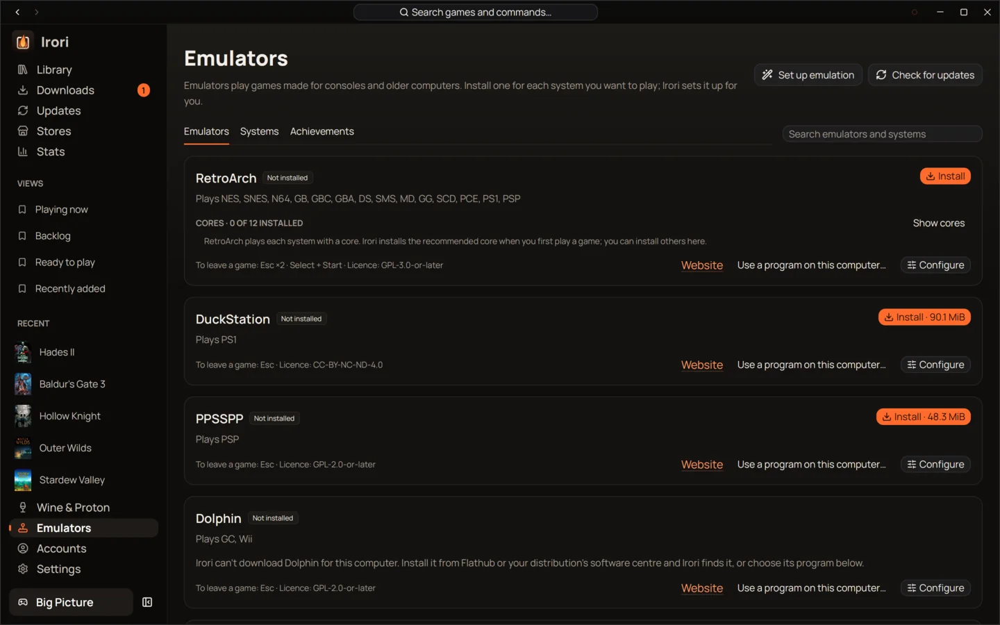
  </picture><br><sub><b>Emulators</b></sub>
</p>

## Big Picture and your play time

- **Big Picture** for the couch: Home's shelves and a filterable Library grid glide over
  the focused game's art, each game has a page of actions (with Play with logs and the
  game's live log beside them), and the button hints match the controller in hand
  (Xbox, PlayStation including DualSense, Switch Pro, Steam Deck), with hotplug, battery
  display and scaling up to 200 % for TVs. A mouse works too. It opens by itself in the
  Steam Deck's Game Mode, from anywhere when you hold Start for a second, and reads
  each press once alongside Steam Input.
- **Game modes** (single player, co-op, split screen and local, online, MMO) from
  Steam, GOG and PCGamingWiki, as chips on each game's page and as a library filter,
  grouping (<kbd>Ctrl</kbd> <kbd>Alt</kbd> <kbd>G</kbd>), saved views and search
  (`mode:coop`, `mode:local`); edit them per game.
- **Age ratings** (ESRB, PEGI, USK, CERO, ClassInd, GRAC, ACB…) on each game's page, in
  the board of your region, with their content descriptors, and a library filter by
  age that a saved view keeps, for a view of the games that suit your children.
- **Play status** for every game (plan to play, playing, on hold, beaten, abandoned),
  with the library grouped by it and play time under each cover (<kbd>Ctrl</kbd>
  <kbd>G</kbd>).
- **Stats** over your games' art: play time by week, month, year or all time against
  the period before, a day-by-day chart per game, streaks, comebacks and new games, and
  a backlog with a yearly goal, its pace and a timeline of what you beat.
- **Year in review**: any year you played, told as full-window stories over your
  games' art (top games, month by month, records, when you play, comebacks, what you
  started and beat), ending on a card you can save as an image.
- **A play journal**: a note for each day you played a game, with that day's
  screenshots, written from the game's play history and gathered in Stats.
- **An album of your screenshots** per game and period: the ones Steam keeps, and the
  ones your desktop saves (Spectacle, GNOME, Game Bar, macOS) while a game you started
  from Irori runs. Irori only reads them.

<p align="center">
  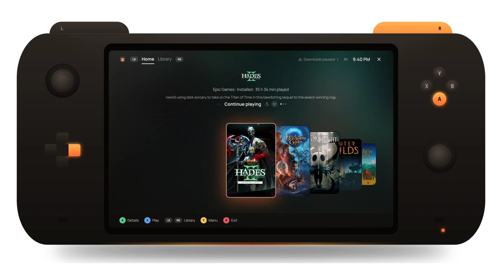
</p>

<table>
  <tr>
    <td width="50%" align="center">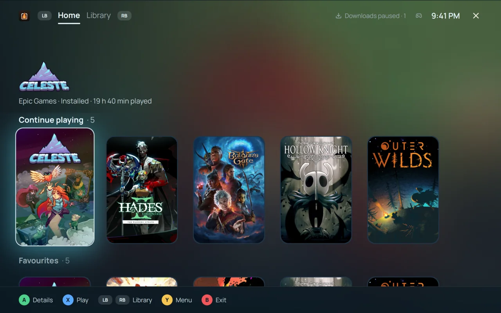<br><sub><b>Big Picture: eight themes, six layouts</b></sub></td>
    <td width="50%" align="center">
      <picture>
        <source media="(prefers-color-scheme: light)" srcset="website/public/screenshots/light-stats.webp">
        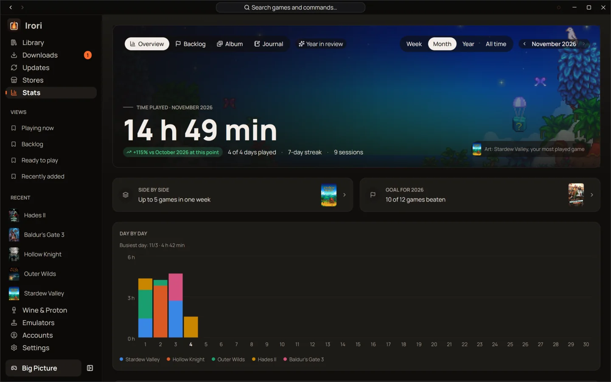
      </picture><br><sub><b>Stats</b></sub>
    </td>
  </tr>
</table>

## Make it yours

- **19 languages**, switchable live: English, Czech, German, Spanish, French, Italian,
  Dutch, Polish, Portuguese (Portugal and Brazil), Romanian, Swedish, Turkish, Russian,
  Ukrainian, Japanese, Korean and Chinese (Simplified and Traditional).
- **Themes**, light and dark, with translucent windows over macOS vibrancy, Windows 11
  Mica or the Linux compositor's blur. On KDE Plasma, COSMIC and Omarchy Irori follows
  your desktop's theme; elsewhere it takes the system's accent colour (GNOME and other
  Linux desktops, macOS, Windows), live as you change it. Turn it on and it follows the
  colours pywal, wallust or matugen take from your wallpaper. An `appearance.json` in the
  config folder lays your own colours over any theme, live as you save it. It honours
  Increase contrast, Reduce transparency and Windows high contrast.
- **Any interface size**, with <kbd>Ctrl</kbd> <kbd>+</kbd> / <kbd>−</kbd> / <kbd>0</kbd>
  or in Settings, on top of the text size your system asks for.
- **Searchable settings**, a tray menu with your recent games, and a log you can upload
  in one click.

<p align="center">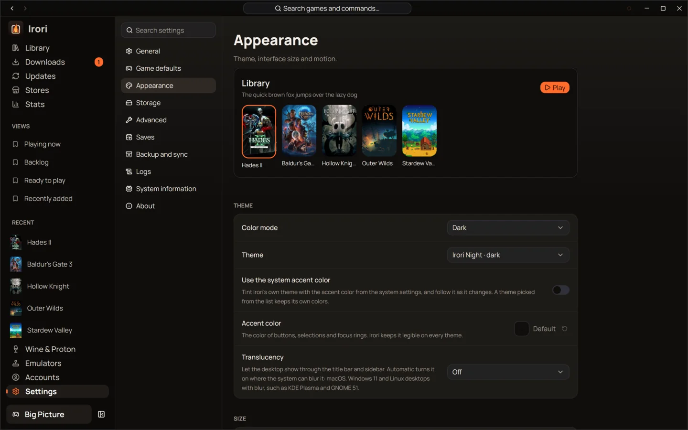</p>

## Light on your PC

One native process drawn on the GPU, with no bundled browser and no store tools to
download.

| | Irori 0.2.0 |
| :--- | :--- |
| Memory with the window open | **~88 MiB** in one process |
| CPU while idle | **0 %** |
| Program size | **76 MB** |

Measured on Linux with an empty profile; Heroic 2.22.4 on the same PC used about
478 MiB across seven processes. A large library hasn't been measured yet; see
[how these numbers were measured](docs/BENCHMARKS.md). Cover art is decoded once into
on-disk thumbnails and held in an LRU GPU cache, and every long list is virtualized.

## Building

Requirements: Rust 1.95+. See [platform support and packaging](docs/PLATFORMS.md) for macOS and Windows. Linux needs the usual GPUI system libraries (Vulkan, Wayland, X11/xcb,
xkbcommon, fontconfig, freetype). The sign-in window (`cargo build -p irori-sign-in`)
also needs WebKitGTK 4.1 (`webkit2gtk4.1-devel` on Fedora, `libwebkit2gtk-4.1-dev` on
Debian/Ubuntu); Irori runs without it. Store downloads, updates and cloud saves are
built in: Irori needs no external store tools.

```bash
cargo run --release -p irori
```

Install for your user (binary, desktop entry, icon and `irori://` handler):

```bash
packaging/install.sh
```

## Layout

| Crate | Purpose |
| --- | --- |
| `crates/core` | Domain types, settings schema, the `Store` trait, process/HTTP/JSON utilities |
| `crates/runtime` | Wine/Proton discovery and downloads, prefixes, DXVK/VKD3D, launch environment |
| `crates/store-*` | One store backend each: Epic, GOG, Amazon, ZOOM, itch.io, Steam, sideloaded apps |
| `crates/depot` | Shared download engine: parallel chunked downloads, resume, verify/repair, delta updates |
| `crates/epic`, `crates/gog`, `crates/amazon` | Store protocols (Rust ports of legendary, gogdl and nile) |
| `crates/gog-galaxy`, `crates/comet` | GOG Galaxy communication service for games (a small fork of comet, as a library) |
| `crates/extras` | Shortcuts, wiki/ProtonDB/anticheat info, SteamGridDB, IGDB, Heroic import |
| `crates/services` | Backend facade: library, settings, download queue, launching |
| `crates/ui` | Shared UI layer: models, navigation, art pipeline, theme, components |
| `crates/feature-*` | Screens: library, game page, settings, downloads/Wine/accounts, Big Picture |
| `crates/*/locales` | Translation catalogs per crate (`docs/I18N_BRIEF.md`) |
| `crates/irori` | The application shell and binary |

`docs/parity/` documents the behaviour Irori matches, `docs/AGENT_BRIEF.md`,
`docs/UI_BRIEF.md` and `docs/I18N_BRIEF.md` the engineering rules.

## Notes

- Store logins open in Irori's sign-in window (`irori-sign-in`, a small helper process
  using WebKitGTK on Linux, WKWebView on macOS, and WebView2 on Windows) and finish on their own: Irori never needs anything copied. On macOS
  and Windows, Irori shows the window itself when the helper isn't built (as after
  `cargo run -p irori`). On Linux without the helper, or with "Use the browser instead",
  the page opens in your browser and Irori watches the clipboard for the code or redirect URL.
- Stores → Open store shows a store's website in a window of its own, run by the same
  helper, with back, forward, reload, the address and "Open in browser". Each store keeps
  its cookies there, and the library refreshes when the window closes, so a game you
  bought appears. Without the helper the store opens in your browser.
- Discord Rich Presence needs a Discord application ID (Settings → General → Integrations).
- Settings → General → Integrations → Sunshine keeps your installed games (or favourites)
  among [Sunshine](https://app.lizardbyte.dev/Sunshine/)'s applications, with their covers,
  so Moonlight can start them from a phone, TV or another computer. Enter the user name and
  password of Sunshine's web UI once. Quitting in Moonlight stops the game in Irori; an
  "Irori Big Picture" application opens Big Picture for the couch. Apollo works too. Games in
  gamescope take the streaming device's resolution, frame rate and HDR, and a game's own
  settings can leave it out of Sunshine (Launch → Streaming).
- Data uses each operating system’s application-data and cache directories;
  `IRORI_HOME` relocates all of it. See [platform paths](docs/PLATFORMS.md#paths-and-desktop-behavior).

## License

MIT, see [LICENSE](LICENSE). Bundled community themes are from GPUI Kit (Apache-2.0),
and the Galaxy service uses a fork of comet (Apache-2.0, `crates/comet`). The store protocol crates are Rust ports
of the parts of legendary, gogdl and nile that Irori needs.

## Contributing

Read [CONTRIBUTING.md](CONTRIBUTING.md) before opening a pull request. Everyone taking
part in the project follows the [code of conduct](CODE_OF_CONDUCT.md).
