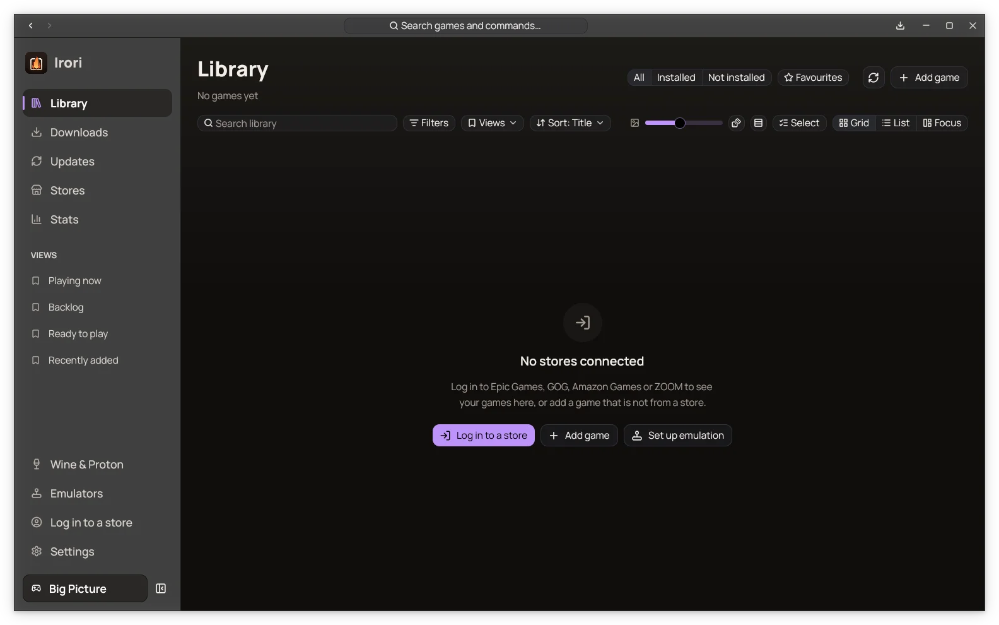
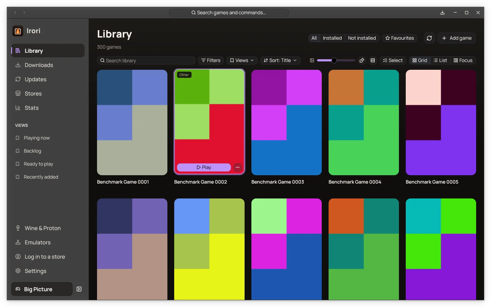
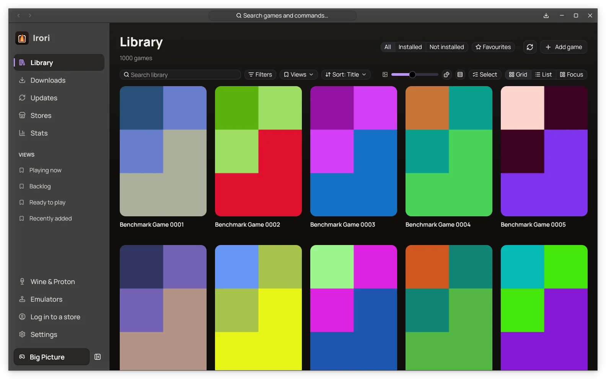

# Benchmarks

How the numbers in the README and on [irori.app](https://irori.app) were measured,
so anyone can check them.

## Irori 1.1.0 across 0, 300, 1,000, and real multi-store libraries

Measured on 25 November 2026 on CachyOS (Linux `7.3.5-2-cachyos-bore`, KDE Plasma
on Wayland) with an AMD Radeon RX 9070 XT (`radv`, Mesa `26.3.1-arch3.5`) using
the `irori 1.1.0` release binary (`/usr/bin/irori`, `108.1 MB`). This run uses
the `1.1.0` release binary as the pre-v1.3 baseline and should be re-run once
`v1.3.0` is tagged.

Each scenario ran 2 rounds with `--settle 45` and `--idle 30` (`compare.py`
strips host overlay environment variables such as `MANGOHUD` so FPS HUD polling
does not skew launcher measurements):

- Synthetic runs (0, 300, and 1,000 games): throwaway `IRORI_HOME`, seeded with
  multi-paragraph descriptions, developers, release dates, genres, `300x450`
  cover PNGs, and `1280x720` hero PNGs.
- Real multi-store profile (`1,440` games in the library UI; `916` listed by
  `irori list`): active multi-store library opened in Focus view with cached
  store covers, screenshots, descriptions, ProtonDB, and HowLongToBeat metadata.

| Scenario | Memory PSS (median) | Memory PSS (rounds) | Processes | Idle CPU (median) | Binary size |
| --- | --- | --- | --- | --- | --- |
| 0 games (synthetic empty) | 122.4 MiB | 122.5, 122.2 MiB | 1 | 0.02 % | 108.1 MB |
| 300 games (rich synthetic + art) | 146.8 MiB | 155.4, 138.1 MiB | 1 | 0.00 % | 108.1 MB |
| 1,000 games (rich synthetic + art) | 147.7 MiB | 150.3, 145.0 MiB | 1 | 0.02 % | 108.1 MB |
| 1,440 games (real multi-store Focus view) | 385.1 MiB | 336.3, 433.9 MiB | 1 | 0.03 % | 108.1 MB |

To repeat the synthetic suite on Linux:

```bash
python3 docs/benchmarks/compare.py --irori /usr/bin/irori --irori-only \
  --library-sizes 0,300,1000 --rounds 2 --settle 45 --idle 30 --output results.csv
```

To measure your own existing profile (aggregate process/memory/CPU only):

```bash
python3 docs/benchmarks/compare.py --irori /usr/bin/irori --irori-only \
  --real-profile --rounds 2 --settle 45 --idle 30 --output real.csv
```

### Benchmark Screenshots

0 games (empty throwaway profile, 122.4 MiB median PSS):



300 seeded games with rendered cover art (146.8 MiB median PSS):



1,000 seeded games with rendered cover art (147.7 MiB median PSS):



## Irori 0.2.0 and Heroic 2.22.4 (Historical baseline)

| | Irori 0.2.0 | Heroic 2.22.4 |
| --- | --- | --- |
| Memory (median of 3 rounds) | 87.5 MiB | 478.2 MiB |
| Memory (all rounds) | 87.4 to 92.2 MiB | 472.7 to 483.4 MiB |
| Processes | 1 | 7 |
| CPU while idle, % of one core | 0.0, 0.0, 0.0 | 6.6, 0.2, 7.1 |
| Program size | 76 MB | 368 MB |

Measured on 30 October 2026 on Nobara (Linux 7.2, KDE on Wayland) with an AMD
Radeon RX 7900 XTX (`--settle 45`, `--idle 30`, empty profile). Irori was the
`irori` binary from the 0.2.0 Linux tarball, and Heroic was Fedora's
`heroic-games-launcher` package. Program size is that binary for Irori and
`/usr/lib64/heroic` for Heroic, which includes the store tools Heroic ships with.

## Method

[`benchmarks/compare.py`](benchmarks/compare.py) runs each app with a throwaway
home directory by default (or the active user profile with `--real-profile`):
window open at its default size, stripping host overlay variables (`MANGOHUD`,
`ENABLE_VKBASALT`, `OBS_VKCAPTURE`, `GALLIUM_HUD`) unless `--keep-overlays` is
passed. In comparison mode (`--irori` and `--heroic`), it alternates between both
apps. In each round it:

1. Starts the app in a new session, so every process it spawns can be found.
2. Waits for startup work to settle (`--settle`, 45 seconds by default).
3. Counts the session's CPU time over the idle window (`--idle`, 30 seconds by
   default), as a percentage of one core.
4. Reads memory as the sum of each process's PSS from `/proc/<pid>/smaps_rollup`.
   PSS divides shared pages between the processes using them, so an app with
   several processes isn't counted twice for the same memory.
5. Closes the app.

To repeat the Heroic comparison when both apps are installed:

```bash
python3 docs/benchmarks/compare.py --irori irori --heroic heroic
```

## Limits

- Synthetic 300- and 1,000-game runs measure cold open and virtualized grid
  rendering with local art and text, not active scrolling stress or live store
  API sync. The `1,440`-game real-profile row covers an active multi-store
  library settled in Focus view.
- Video memory (VRAM) isn't counted for either app.
- Each benchmark reflects one machine; other drivers, compositors, and window
  sizes will produce different numbers.
