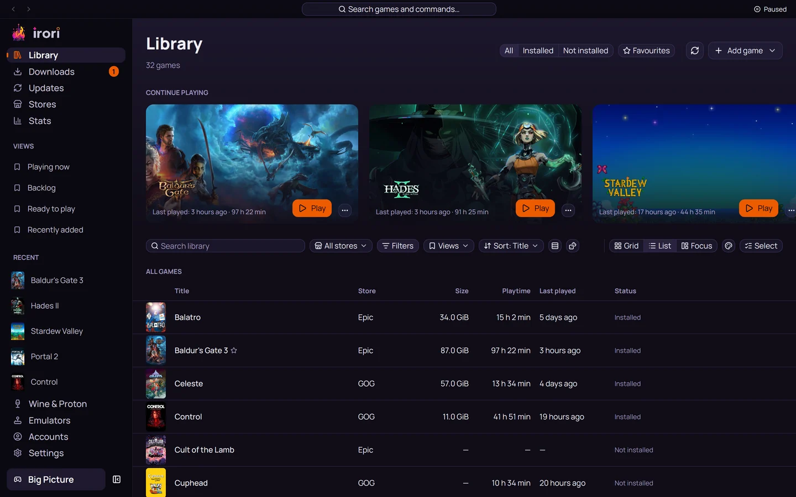
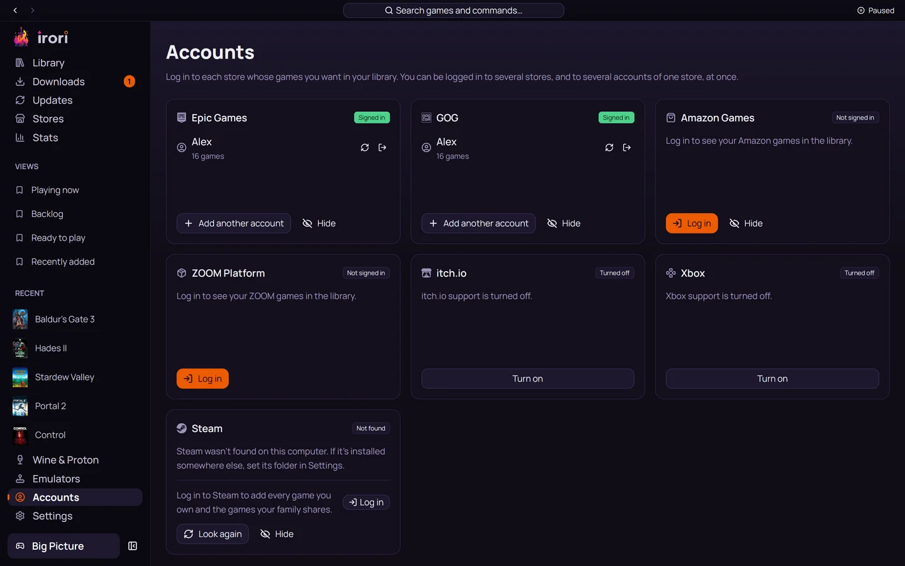
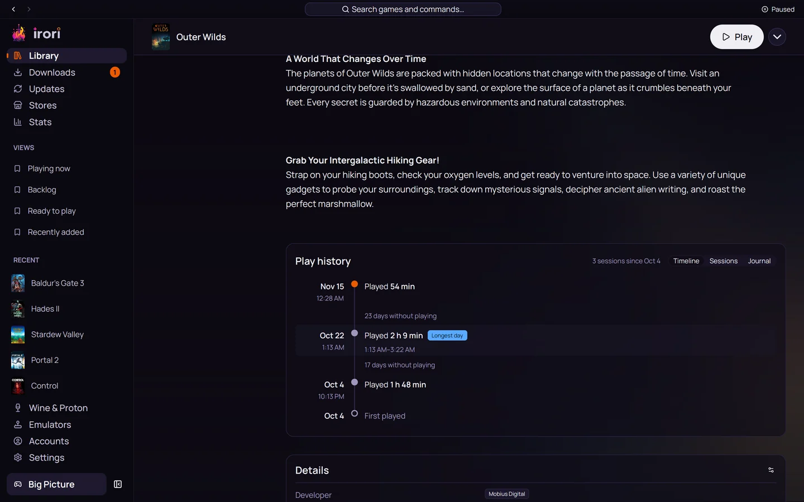
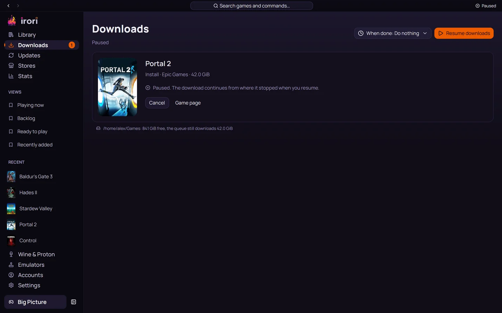
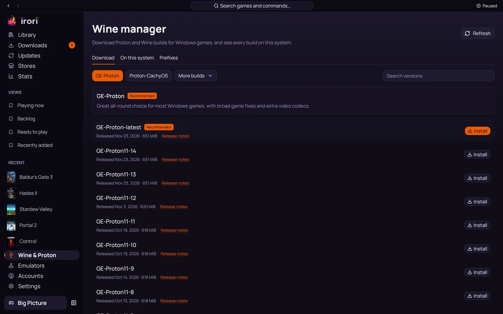
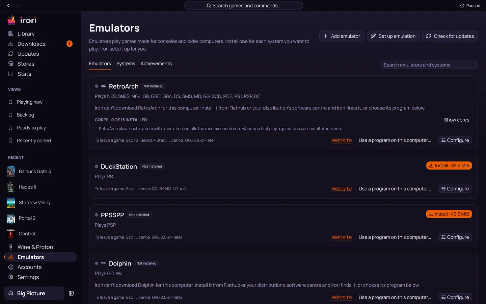

# Irori Features

This document holds the full feature reference previously inline in `README.md`. For platform paths and technical details, see [PLATFORMS.md](PLATFORMS.md).

## Stores and Library

- Epic Games, GOG, Amazon Games, ZOOM Platform, and itch.io integration using built-in Rust store clients and a unified download queue (pause, resume, reordering, speed and remaining time, verification, delta updates, and multiple accounts per store).
- Microsoft Store and PC Game Pass on Linux behind the Xbox integration toggle (experimental), using built-in `msixvc` and `msstore` support with Nexus Runtime (`xgameruntime.dll`) from the Wine manager.
- Xbox app and PC Game Pass detection on Windows when "Other launchers" is enabled, launching natively without extra sign-in.
- Steam integration reading local manifests and artwork without requiring a login, plus optional QR or Steam Guard login to include owned and Steam Family libraries, playtime tracking, Proton version selection (`CompatToolMapping`), and ProtonDB ratings.
- Friends status for Steam and Xbox (read only while the window is open, with no friend list support exposed by Epic, GOG, or Discord).
- Virtualized grid, sortable list, and Focus views (`Alt+1` to `Alt+3`) with fuzzy search, genre and mode filters, manual and rule-based smart categories, multi-select batch actions (`Ctrl+click`, `Shift+click`, `Ctrl+A`), and unified multi-store game entries that let you switch or split copies.
- Sideloaded apps (`SideloadStore`) via add/edit dialogs or drag-and-drop for native executables, Windows programs, and web apps, with custom artwork from local files, screenshots, or SteamGridDB.
- Optional metadata enrichment from IGDB (using your own Twitch app credentials, on demand when opening a game) and VNDB (anonymous, spoiler-filtered, explicit images excluded).
- One-click migration and import from Heroic, Lutris, Bottles, Faugus Launcher, and Playnite (on Windows), carrying over accounts, installs, settings, favourites, categories, and playtime.

  
  

## Launching, Tools, and Saves

- Launch from library tiles, the game page, the `Ctrl+K` command palette, the system tray, desktop shortcuts, Steam shortcuts (`irori steam-shortcuts` and "Add to Steam"), and `irori://` or `heroic://` URIs.
- Per-game settings inheriting global defaults with explicit override indicators, daily session timelines, 1 to 5 star ratings, screenshots, trailers, and details tables.
- Cloud saves for Epic Games and GOG, GOG Galaxy achievements and playtime, EOS overlay toggle, ProtonDB, Steam Deck, anticheat, and HowLongToBeat lookups.
- Automatic and manual save backups via Ludusavi looking directly inside each game's Wine or Proton prefix.
- Discord Rich Presence, sleep inhibition while playing, live filterable game logs, and automatic desktop screenshot / gpu-screen-recorder replay clip indexing.

  
  

## Downloads and Updates

- Single download queue for games, runtime tools, and updates, pausing offline and resuming automatically after restarts.
- Unified Updates view covering games, Wine/Proton builds, DXVK, VKD3D-Proton, umu, anticheat runtimes, emulators, RetroArch cores, and Irori update checks, with version pinning and metered-connection / active-hours controls.

  
  

## Wine, Proton, Graphics, and Third-Party Launchers

- Wine manager on Linux (`GE-Proton`, `Proton-CachyOS`, `Proton-Wineland`, `DW-Proton`, `UMU-Proton`, `Proton-EM`, `Proton-Sarek`, `Wine-GE`, `Kron4ek`) and macOS (`Game-Porting-Toolkit`, `Wine-Crossover`, `Wine-Staging-macOS`), plus discovery of system, Steam, Lutris, Bottles, CrossOver, and Whisky runtimes.
- Built-in toggles for gamescope, GameMode, DXVK/VKD3D-Proton version selection, DLSS/FSR/XeSS upgrades, 10 GB Mesa/NVIDIA shader cache sizing, NTSync, and Winetricks/Protontricks.
- Per-game in-game overlay configuration for MangoHud on Linux (with live preview, Steam launch options copy with an interactive paste guide, and per-game overrides) and Metal HUD on macOS.
- Linux GPU selection (`DRI_PRIME`, `MESA_VK_DEVICE_SELECT`, PRIME render offload), NVIDIA Smooth Motion, NVIDIA Reflex for Vulkan games, frame generation via `lsfg-vk` or MAKO, and Windows per-program GPU preference (`UserGpuPreferences`) or temporary device hiding.
- Third-party launcher prefix management for Battle.net, the EA app, Ubisoft Connect, and the Rockstar Games Launcher on Linux, plus confined Lutris install-script execution with consent previews and rollback.
- ReShade, RenoDX HDR, and OptiScaler (with global defaults, menu shortcut sync, proxy conflict confirmation, and support for Steam Windows builds on Linux) from official releases with SHA-256 hash tracking for clean removal.

## Emulators and ROMs

- Managed downloads and side-by-side versions for RetroArch, DuckStation, PCSX2, Dolphin, PPSSPP, melonDS, mGBA, Azahar, ScummVM, DOSBox Staging, and other engines from their official servers.
- Watched ROM folders with filename-based system, region, and revision detection, BIOS verification before launch, and opt-in regional box art from the LaunchBox Games Database.

  

## Big Picture, Stats, and Customization

- Full controller interface (`Ctrl+Shift+B` or holding Guide) with eight themes, six layouts, hotplug support, battery indicators, TV scaling up to 200%, automatic activation in Steam Deck Game Mode, and power/session controls.
- Play status tracking, age ratings (ESRB, PEGI, USK, CERO, ClassInd, GRAC, ACB), game modes (`mode:coop`, `mode:local`), Stats dashboards, Year in Review summaries, and daily play journals.
- 19 live-switchable interface languages, system theme and accent tracking (plus pywal, wallust, matugen, and `appearance.json` overrides), Sunshine/Apollo streaming sync, searchable settings, and one-click UI scaling (`Ctrl++`, `Ctrl+-`, `Ctrl+0`).

  

