# Irori Features

This document holds the full feature reference alongside the concise overview in [README.md](../README.md). For platform paths and technical details, see [PLATFORMS.md](PLATFORMS.md).

## Stores, Library, and Deals

- Epic Games, GOG, Amazon Games, ZOOM Platform, and itch.io integration using built-in Rust store clients and a unified download queue (pause, resume, reordering, speed and remaining time, verification, delta updates, optional per-store install folders, and multiple accounts per store).
- Microsoft Store and PC Game Pass on Linux behind the Xbox integration toggle (experimental), using built-in `msixvc` and `msstore` support with Nexus Runtime (`xgameruntime.dll`) from the Wine manager.
- Xbox app and PC Game Pass detection on Windows when "Other launchers" is enabled, launching natively without extra sign-in.
- Steam integration reading local manifests and artwork across every Steam installation without requiring a login, plus optional Valve web sign-in or a personal Steam Web API key to include owned and Steam Family libraries, playtime tracking, Proton version selection (`CompatToolMapping`), launch option editing, and ProtonDB ratings.
- Friends status for Steam and Xbox (read only while the window is open, with no friend list support exposed by Epic, GOG, or Discord).
- Tabbed library (`All`, `Installed`, `Favorites`, `Recently added`) with a drag-to-reorder `Edit tabs` manager, per-tab saved visualization settings, Steam-style hybrid collections combining automatic tag and genre rules with manual game picks and exclusions (plus custom colors, 24 curated icons with tag-based suggestions, and sidebar pinning), virtualized grid, sortable configurable list, and Focus views (`Alt+1` to `Alt+3`).
- Library usability touches including ProtonDB tier and Steam Deck Verified/Playable badges on covers and List view, optional time-of-day greeting, `On hover` artwork-first cover captions, a `Surprise me` shuffle card with cover art, score, tags, and synopsis, fuzzy search, multi-select batch actions (`Ctrl+click`, `Shift+click`, `Ctrl+A`), and unified multi-store entries that let you switch or split copies.
- Stores and Deals tabs with a "Free to claim" section, global search, regional filters, multi-currency historical low highlights, a persistent toggle to hide games you already own, ProtonDB compatibility ratings on deals, and optional GG.deals API key support with guided setup.
- Sideloaded apps (`SideloadStore`) via `Add game` or drag-and-drop for native executables, Windows programs, and web apps. Running Windows `.exe` or `.msi` installers (including Inno Setup repacks) inside a game's prefix automatically detects the newly installed executable when setup finishes (with an inline picker when multiple plausible binaries exist), infers clean titles from parent folders for `setup.exe`, and auto-fills cover and hero art via Steam store search alongside local files, screenshots, or SteamGridDB.
- Optional metadata enrichment from IGDB (using your own Twitch app credentials, on demand when opening a game) and VNDB (anonymous, spoiler-filtered, explicit images excluded).
- One-click migration and import from Heroic, Lutris, Bottles, Faugus Launcher, and Playnite (on Windows), carrying over accounts, installs, settings, favourites, categories, and playtime.

  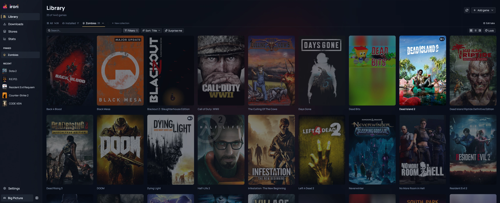 
  <b>Tabbed library with pinned hybrid collections and multi-store game entries</b>

  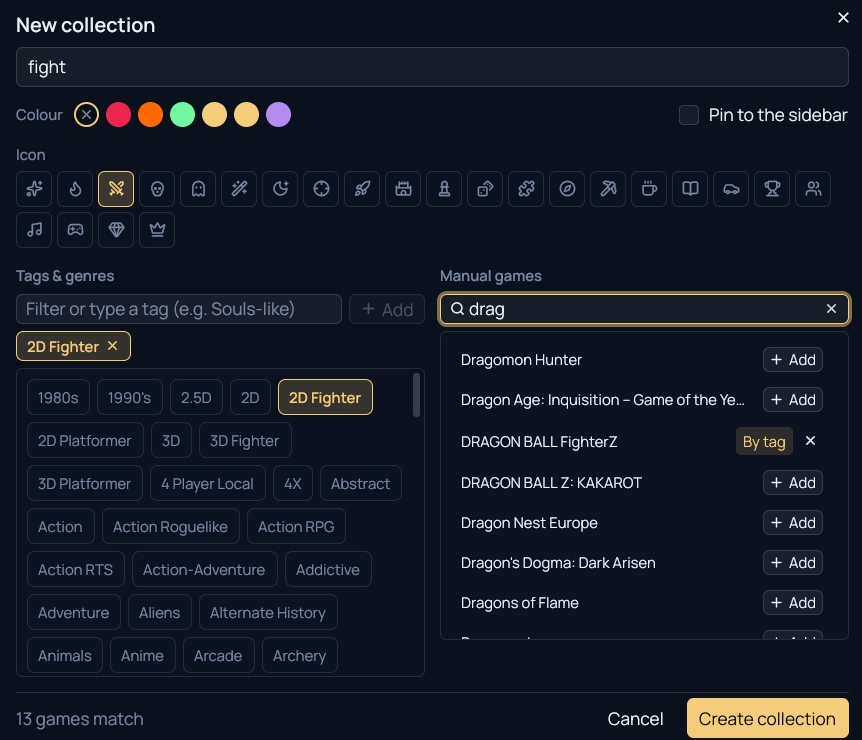 
  <b>Hybrid collection builder combining automatic tag rules and manual picks</b>

  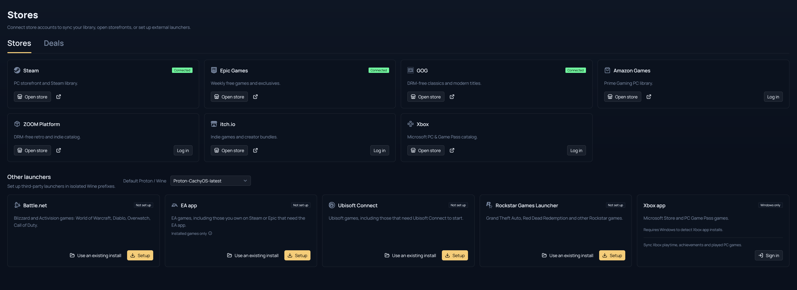 
  <b>Stores and third-party launchers configured in one place</b>

  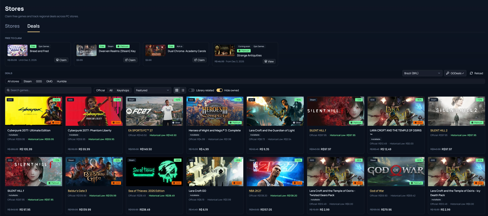 
  <b>Deals view with Free to claim games, historical lows, GG.deals, and ProtonDB ratings</b>

## Launching, Tools, Mods, and Saves

- Centered install and modify modal displaying game cover, store icon, publisher, three storage cards (`Download`, `Space needed`, `Free after`), clickable saved library folders and local drives with usage bars, and technical options tucked inside "More options".
- Launch from library tiles, the game page, the `Ctrl+K` command palette (with game covers, previews, and per-game actions), the system tray, desktop shortcuts, Steam shortcuts (`irori steam-shortcuts` and "Add to Steam"), and `irori://` or `heroic://` URIs.
- Plain-language explanations for failed launches with one-click fixes, plus a persistent post-crash notification opening a structured crash report viewer with automatic personal home-path redaction (`~` or `%USERPROFILE%`), sanitized copy/upload actions, a prefilled GitHub issue link, and the 5 most recent reports under `Settings > Logs`.
- Per-game settings inheriting global defaults with explicit override indicators, launch presets, pre-launch scripts and companion programs, daily session timelines, 1 to 5 star ratings, screenshots, trailers, PCGamingWiki facts, hardware compatibility hints, and details tables.
- Per-game mod manager supporting in-app Nexus Mods search, Thunderstore `ror2mm://` installs, FOMOD installers, Bethesda plugin lists and script extender launches, Unreal Engine and nested-folder placement, and proxy DLL overrides. Mods are applied while the game runs and cleaned up afterward.
- Cloud saves for Epic Games and GOG, GOG Galaxy achievements and playtime, EOS overlay toggle, ProtonDB, Steam Deck, anticheat, and HowLongToBeat lookups.
- Automatic and manual save backups via Ludusavi looking directly inside each game's Wine or Proton prefix, with restore into active prefixes, pre-sync snapshots, scheduled backups, and cross-machine sync over a folder, WebDAV, or rclone.
- Linux `bubblewrap` sandbox to run untrusted games with network access blocked, the home folder hidden, or both.
- Discord Rich Presence, sleep inhibition while playing, hide-to-tray while playing, live filterable game logs, and automatic desktop screenshot and `gpu-screen-recorder` replay clip indexing.

  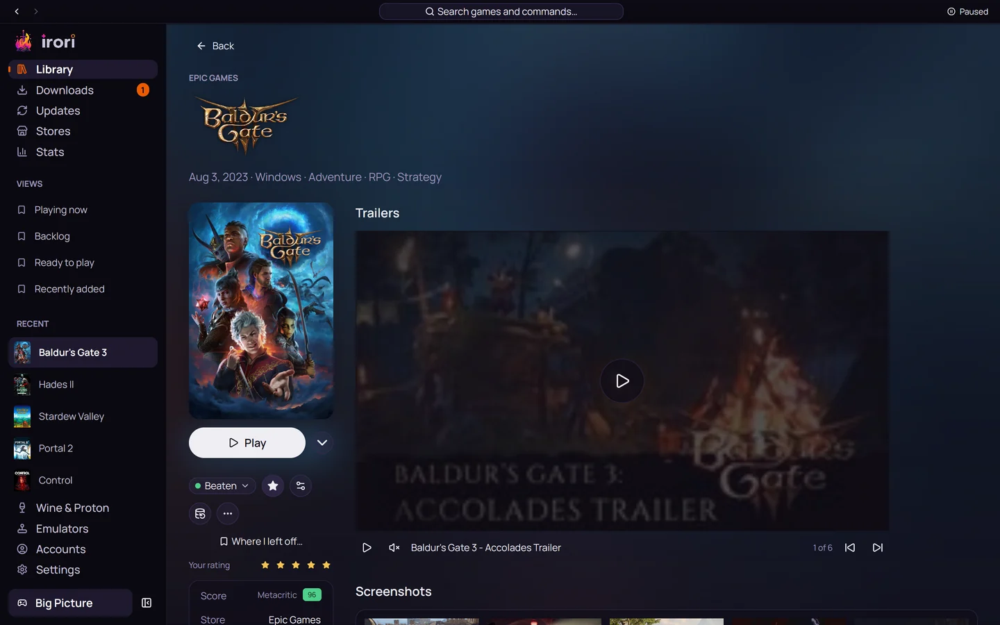
  

## Downloads and Updates

- Single unified **Downloads** view covering active transfers, queued installs, game updates, component updates (Wine/Proton builds, DXVK, VKD3D-Proton, umu, anticheat runtimes, emulators, and RetroArch cores), a dedicated Irori app update banner (separate from "Update all", with copyable `apt`, `dnf`, and `pacman` commands for Linux system packages), offline files, and history.
- "Download now" button to jump any queued item to the front while safely pausing the active download without losing progress, offline auto-pause and automatic resume after restarts, post-download power actions menu, version pinning, metered-connection and active-hours controls, and a live sidebar badge showing transfer percentage, queued count, or pending updates.

  

## Wine, Proton, Graphics, and Third-Party Launchers

- Wine manager on Linux (`Download`, `On this system`, and `Prefixes` tabs) with `GE-Proton` (including RTSP), `Proton-CachyOS`, `Proton-Wineland`, `DW-Proton`, `UMU-Proton`, `Proton-EM`, `Proton-Sarek`, `Wine-GE`, and `Kron4ek`, plus macOS builds (`Game-Porting-Toolkit`, `Wine-Crossover`, `Wine-Staging-macOS`, Rosetta support, and DLSS via MetalFX). Discovers system, Steam, Lutris, Bottles, CrossOver, and Whisky runtimes, registers manager Proton builds with Steam using stable names for `-latest`, auto-updates `-latest` builds with one-click rollback to the previous build, and searches prefixes linked directly to their game pages.
- Built-in toggles for gamescope, GameMode, DXVK/VKD3D-Proton version selection, DLSS/FSR/XeSS upgrades, 10 GB Mesa/NVIDIA shader cache sizing, NTSync, Wine DLL overrides, SDL controller support in Proton, unified FPS capping (`DXVK_CONFIG`, `VKD3D_FRAME_RATE`, and MangoHud) with `Late`/`Early` frame pacing, and Winetricks/Protontricks.
- Global (`Settings > In-game stats`) and per-game (`Inherit global`, `Custom`, `Disabled`) in-game performance HUD configuration for MangoHud on Linux and Metal HUD on macOS. On Linux, includes a pinned live preview (`Dark`, `Scene`, `Bright` backdrops, `Live test`, and preset cycle stepper), quick presets (`Minimal (FPS)`, `Horizontal`, `Balanced`, `Full`, `Custom`, `Custom Horizontal`), live in-game reload, in-game preset cycling via configurable shortcut, a color wheel picker with WCAG contrast warnings, a visual monitor position grid, keycap shortcuts with conflict alerts, bulk metric actions, and side-by-side Steam launch options with an interactive paste guide dialog.
- Dedicated `Replay` sub-tab in global defaults and per-game settings for `gpu-screen-recorder` clip capture.
- Linux GPU selection (`DRI_PRIME`, `MESA_VK_DEVICE_SELECT`, PRIME render offload), NVIDIA Smooth Motion, NVIDIA Reflex for Vulkan games, frame generation via `lsfg-vk` or MAKO, and Windows per-program GPU preference (`UserGpuPreferences`) or temporary device hiding.
- Third-party launcher prefix management for Battle.net, the EA app, Ubisoft Connect, and the Rockstar Games Launcher on Linux, plus confined Lutris install-script execution with consent previews and rollback.
- ReShade (including Steam games and taking over manual installs), RenoDX HDR, and OptiScaler (under `Performance > In-game stats`, with `Stable` and `Nightly` release channels, `Mesa (Auto)` with `FakeNVAPI`, `OptiPatcher`, proxy file selector, global defaults, menu shortcut sync across installed games, centered confirmation dialog before overwriting existing proxy DLLs, automatic Unity render API detection via `UnityPlayer.dll`, and Steam Windows build support on Linux), installed from official releases with SHA-256 hash tracking for clean removal.

  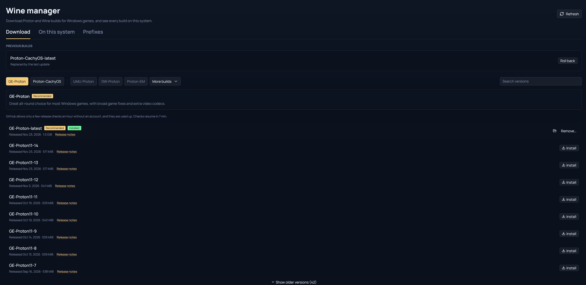 
  <b>Wine and Proton manager with Steam linking, -latest auto-updates, and one-click rollback</b>

<table>
  <tr>
    <td width="50%" align="center" valign="top">
      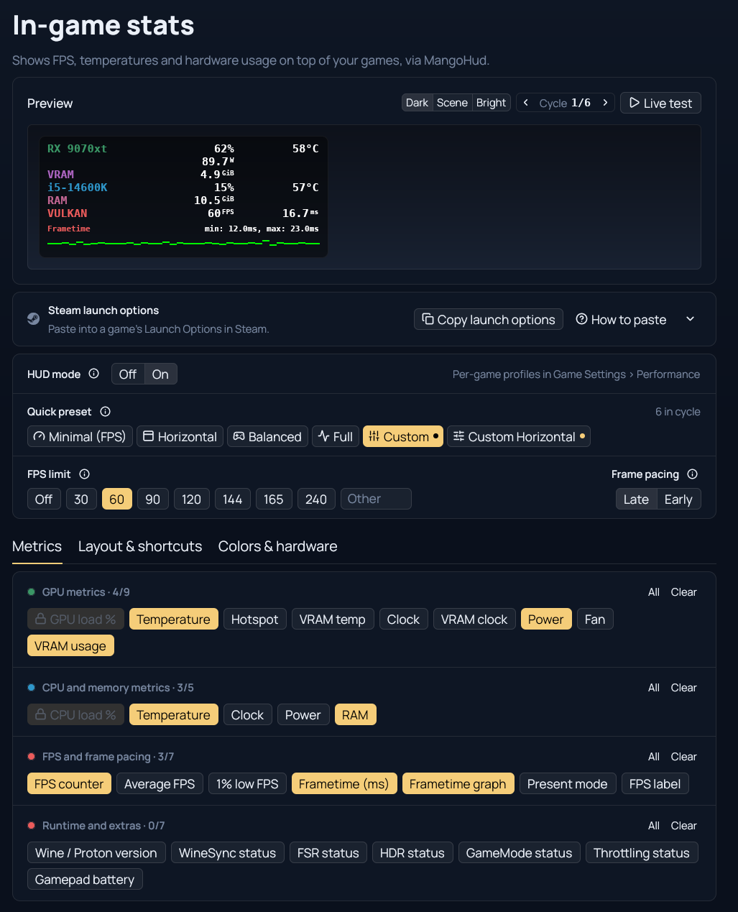 
      <b>MangoHud editor with pinned live preview and Steam paste guide</b>
    </td>
    <td width="50%" align="center" valign="top">
      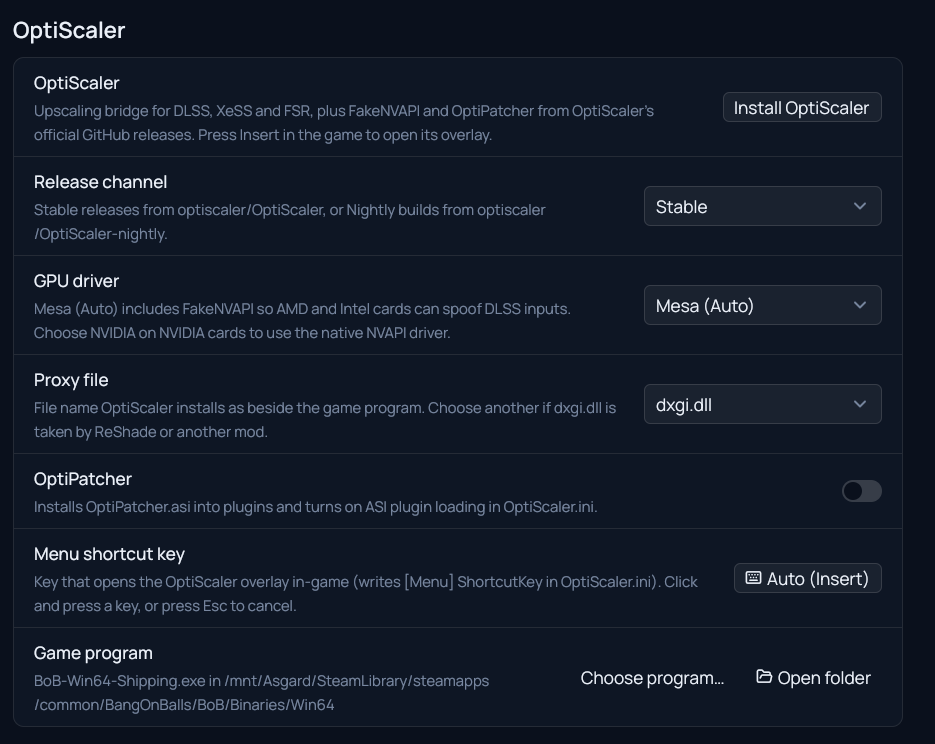 
      <b>OptiScaler with FakeNVAPI, OptiPatcher, and proxy DLL management</b>
    </td>
  </tr>
</table>

## Emulators and ROMs

- Reorganized Emulators page with `Installed`, `Available`, and `Manual` sections, status filters, cards with system chips and overflow menus, a searchable modal for managing RetroArch cores, and custom user-defined emulators.
- Managed downloads and side-by-side versions from official project releases for RetroArch, DuckStation, PCSX2, Dolphin, PPSSPP, melonDS, mGBA, Azahar, Flycast, Gopher64, Vita3K, Ryujinx, ScummVM, DOSBox Staging, and other engines, plus EmuDeck and RetroDECK folder discovery.
- Built-in **DOOM** system with automatic recognition of standalone `IWAD` files (DOOM, DOOM II, Heretic, Hexen, Freedoom) kept separate from `PWAD` mods and Nintendo Wii `.wad` channels, backed by built-in **UZDoom** and **GZDoom** support and LaunchBox cover lookups.
- Watched ROM folders with filename-based system, region, and revision detection, BIOS verification before launch, RetroAchievements tracking, and opt-in regional box art from the LaunchBox Games Database.

  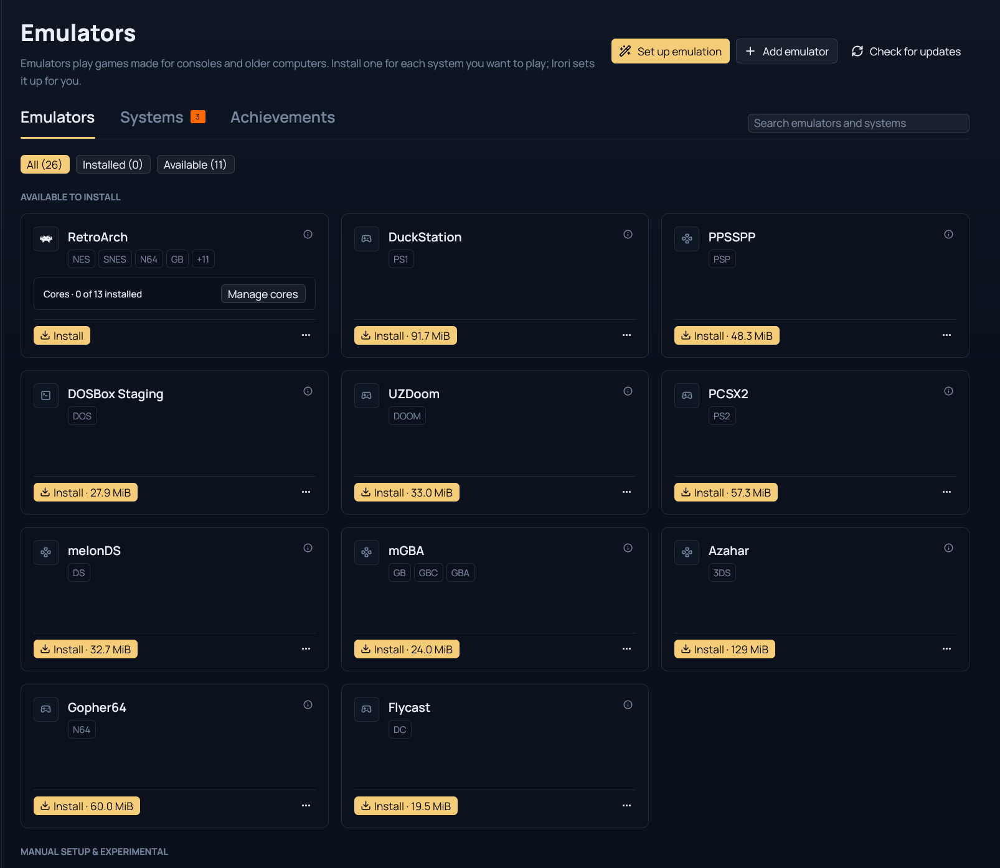

## Big Picture, Stats, and Customization

- Full controller interface (`Ctrl+Shift+B` or holding Guide) with eight themes, six layouts, a theme editor with undo/redo, hotplug support, battery indicators, TV scaling up to 200%, automatic activation in Steam Deck Game Mode, reliable refocus on exit (including Linux KDE Wayland), and power/session controls.
- In-game overlay (opened with Guide or configurable chords, including `Back + Start` on Windows) with microphone, controller, volume, frame limiter, replay clip, and `Mark this moment` controls, plus live in-game achievement unlock toasts.
- Play status tracking, age ratings (ESRB, PEGI, USK, CERO, ClassInd, GRAC, ACB), game modes (`mode:coop`, `mode:local`), Stats dashboards (`Overview`, `Journeys`, `Backlog`, `Discoveries`, `Album`, `Journal`, and `Year in review`), daily session charts, and play journals linked to screenshots.
- Grouped Settings layout (`Preferences`, `Data`, `System`) with collapsible `More options` blocks, focusable `(i)` hover tooltips, searchable settings, 19 live-switchable interface languages, system theme and accent tracking (KDE Plasma, COSMIC, Omarchy, pywal, wallust, matugen, and `appearance.json` overrides), Sunshine/Apollo streaming sync, mouse Back/Forward navigation, and one-click UI scaling (`Ctrl++`, `Ctrl+-`, `Ctrl+0`).

  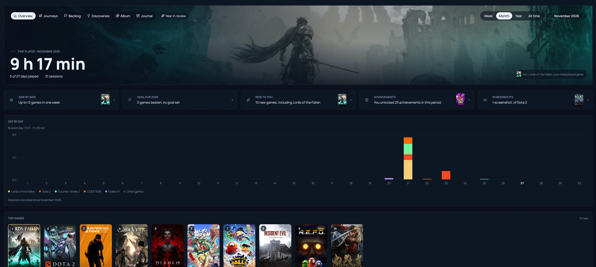 
  <b>Personal Stats dashboard with playtime, goals, achievements, daily chart, and top games</b>

  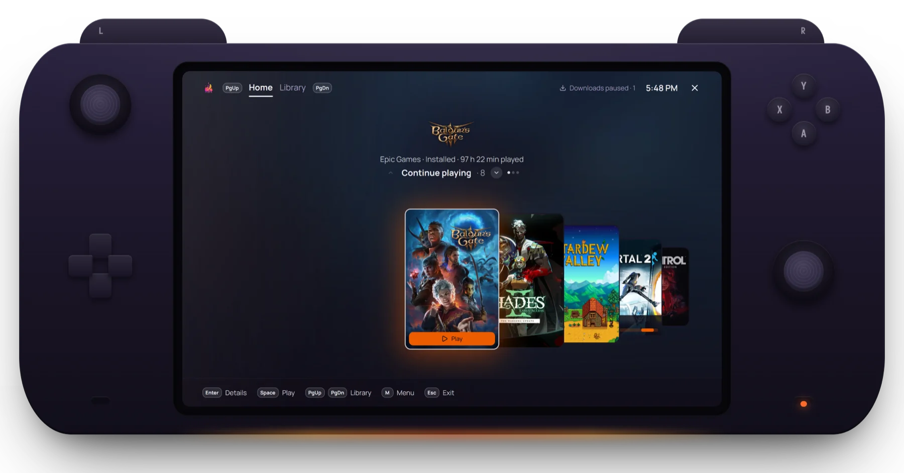

