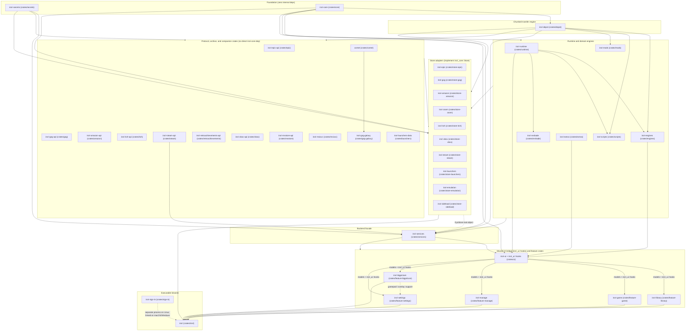
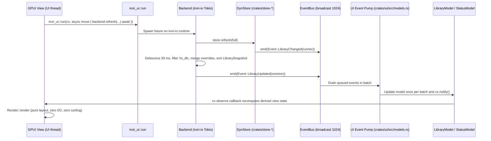
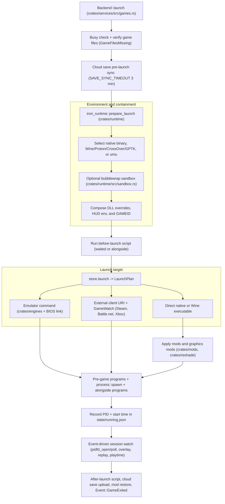
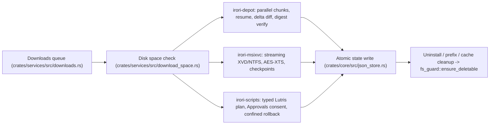
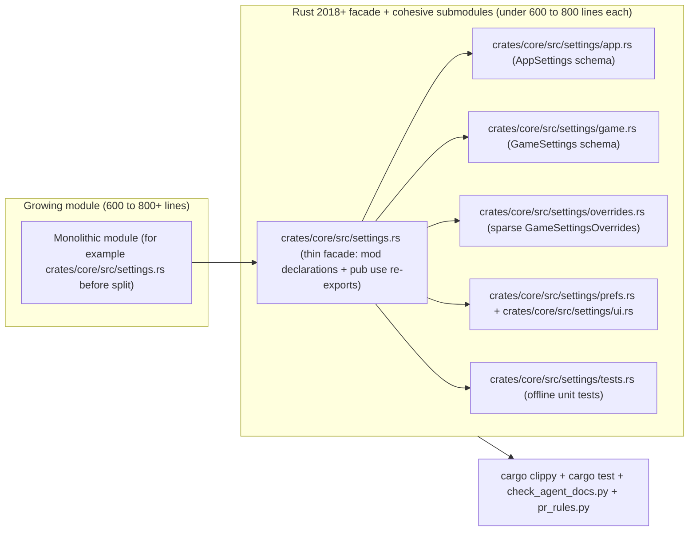

# Architecture Graphs

Canonical Mermaid diagrams for Irori's workspace crate hierarchy, reactive state loop, launch pipeline, download and deletion safety pipeline, and Rust 2018+ submodule split convention.

Every active workspace crate in root `Cargo.toml` must appear in Graph 1, and every explicit repository path referenced in backticks must exist on disk. Automated CI checks in `.github/scripts/check_agent_docs.py` enforce both rules on every pull request.

## 1. Strict workspace crate hierarchy

Dependencies flow strictly downward. Protocol crates never depend directly on `irori-core`, `irori-services` drives stores through `DynStore`, and `feature-*` crates stay decoupled from each other (except `irori-settings` reading `irori-bigpicture` gamepad and overlay support tables; cross-feature UI flows route through `irori_ui::hooks` and shell events).

Vendored `[patch.crates-io]` crates excluded from workspace lints: `crates/gpui-pre-windows` and `crates/gilrs-core`. Detailed crate responsibilities live in [docs/ARCHITECTURE.md](ARCHITECTURE.md).

## 2. Reactive UI, Backend, Store, and EventBus loop

GPUI views never block on I/O and never subscribe to raw `Event::LibraryChanged`. Backend tasks run on the dedicated `irori-io` Tokio runtime, rebuild `Arc<LibrarySnapshot>` with a 30 ms debounce, and emit `Event::LibraryUpdated(rev)` before the batched model pump notifies GPUI observers.

## 3. Game launch and session monitoring pipeline

`Backend::launch` in `crates/services/src/games.rs` orchestrates save sync, runtime preparation, mod deployment, process spawning, and event-driven exit tracking (`pidfd_open` with `poll` on Linux, zero polling at idle).

## 4. Download, install, update, and safe deletion pipeline

`crates/services/src/downloads.rs` persists a single-worker queue in `state/downloads.json`, accounts for per-disk space via `crates/services/src/download_space.rs`, delegates bytes to specialized engines, and routes every recursive deletion through `crates/core/src/fs_guard.rs`.

## 5. Rust 2018+ submodule split pattern

When a `.rs` file approaches 600 to 800 lines, split it into a thin `<area>.rs` sibling facade plus cohesive `<area>/*.rs` submodules instead of growing a monolith, exceeding the 1,500-line `*.rs` PR limit, or breaking external import paths. Real examples on `main` include `crates/core/src/settings.rs` + `crates/core/src/settings/`, `crates/feature-settings/src/form.rs` + `crates/feature-settings/src/form/`, `crates/feature-library/src/view.rs` + `crates/feature-library/src/view/`, and `crates/feature-settings/src/hud/panel.rs` + `crates/feature-settings/src/hud/panel/`.

For step-by-step refactoring instructions and few-shot XML examples (both GPUI views and domain schemas), load [.agents/skills/irori-submodule-refactor/SKILL.md](../.agents/skills/irori-submodule-refactor/SKILL.md).
